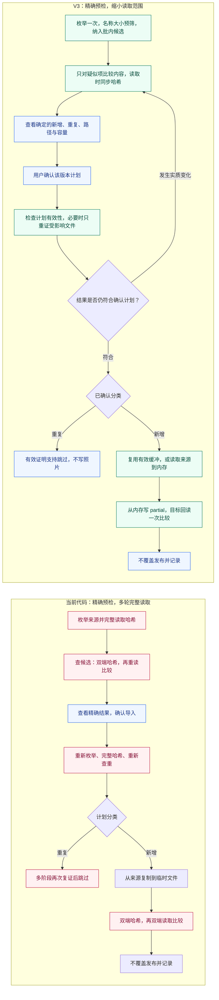
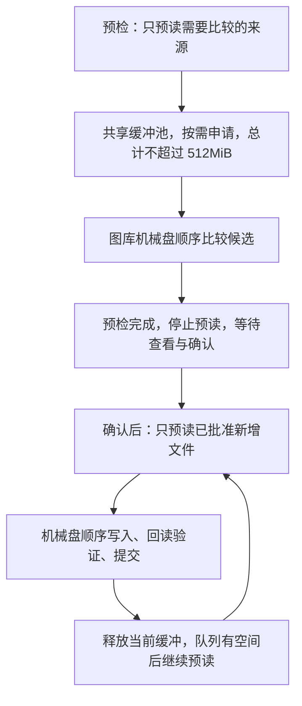
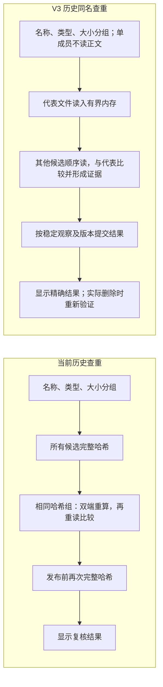

# 新旧导入与查重流程对照：保留精确预检

初稿：2026-09-14；修订：2026-09-16。当前提案为 V3，尚未实施。用户最终确定“精确预检 → 查看结果 → 确认导入”；此前 V2“确认后逐文件确定是否重复”的交互方案不再采用。旧流程计数依据 2026-09-12 审查，不代表本次重新测量。

## 1. 当前代码与 V3 导入流程

两侧都在确认前完成精确预检。变化在候选筛选顺序、证明计算次数、缓冲复用以及确认后的定向复核；确认前不写照片或 partial。图中的新增仅指当前明确检测范围内没有相同内容候选。

确认后的复证用于验证用户看过的计划是否仍成立，不是第一次发现重复。结论相同可继续；分类、路径或保留副本等发生实质变化时，展示更新结果并重新确认。不可读项不能当作新增，预检不确定的文件需要解决或由用户明确排除。

批内重复项依赖计划中的代表文件成功导入，代表失败不能记录依赖项成功跳过。来源之间的比较和实际保留副本复证可能增加读量。

## 2. 本次决定取代 V2 的哪些内容

| 项目 | 此前 V2 提案，已被取代 | 当前 V3 提案 |
| --- | --- | --- |
| 确认前信息 | 疑似重复、空间上限 | 精确新增、重复、保留副本、计划路径及新增容量 |
| 内容查重时机 | 确认后逐文件进行 | 预检阶段完成 |
| 允许写入 | 确认后逐文件首次判定再写 | 确认后仅执行预检计划，必要时校验其仍有效 |
| 来源缓冲复用 | 比较后马上复制，易复用 | 需跨越整批预检和人工等待，不能保证保留 |
| 读取指标 | 典型文件可来源 1 遍、目标 1 遍 | 无候选新增可 1＋1；其他情况按缓冲与证据有效性分别计量 |
| 产品取舍 | 优先缩短确认前等待 | 优先让用户依据精确结果决定导入 |

名称大小预筛、目录一次索引、哈希与比较合并、不要求全库预建完整指纹仍保留。名称大小相同不构成重复证明，任意改名副本不属于当前同名检测的完整覆盖范围。

## 3. 有界多文件缓冲

原文、预读队列、有限保留缓冲及 I/O 工作空间共用预算，不是每张照片或每个阶段各 512MiB；例如预留 8MiB 工作缓冲，其余按文件实际大小分配。多张缓存允许来源读卡与目标处理重叠，不表示多张同时争抢机械硬盘。等待确认时可保留少量有用原文，但不把整批照片暂存到硬盘。

## 4. 读取量对照

以下均为应用逻辑正文读量。旧代码典型计数来自审查；V3 是待实现验收目标。除首候选命中外，额外候选、批内比较、失败重试及少量元数据另计。

| 场景 | 当前代码 | V3 |
| --- | --- | --- |
| 新增，无候选、文件可入缓冲 | 来源约 5 遍，目标约 2 遍 | 来源 1 遍，目标验证 1 遍 |
| 新增，有候选但不同，预检缓冲已释放 | 多阶段读取，取决于候选 | 来源约 2 遍，目标验证 1 遍，另加候选探测 |
| 新增，有候选但不同，有效原文仍保留 | 多阶段读取，取决于候选 | 来源 1 遍，目标验证 1 遍，另加候选探测 |
| 重复，首候选命中，连续性无法证明 | 来源约 10 遍，候选约 8 遍 | 预检双方各 1 遍，确认后复证双方各 1 遍，合计各 2 遍 |
| 重复，首候选命中，连续性可靠有效 | 同上 | 允许双方各 1 遍；必须验证复用条件，不能默认成立 |
| 超预算新增，无候选 | 同当前旧路径 | 流式执行来源约 2 遍，目标验证 1 遍 |

长度、mtime、路径相同或普通句柄仍存在，不足以证明内容一直未变。预检保护已释放、应用重启、拔卡或身份不可靠时，应按需要复证估算，不能继续无条件声称重复只读 1＋1。

50GB/100GB 全部为无候选、可入缓冲的新增时，来源读、目标读、目标写分别约为 50GB/100GB。混合批次按实际候选及失效比例增加。逻辑读量不是机械盘物理吞吐，也不能直接换算耗时倍数。

## 5. 历史同名重复检测的对照

单一同内容组、代表可入预算且无失效/重试时，n 个 S 大小文件可读 nS；原扫描约 (6n−4)S。多个内容类别、淘汰或句柄限制可能补读；此计数不包含用户之后标记及回收时的重新验证。

## 6. 审查问题的处理边界

全部 21 项问题仍保留在[新版设计逐项核对](D:/A/MyProject/ai/Aifirtst/docs/superpowers/specs/2026-09-14-minimal-read-import-dedup-proposal.md)中。F01 的目标改为“保留精确预检并减少重复读取”，不承诺把确认前后全部证明合并成一轮。计划有效性和 L02 权威版本、L03 原卡恢复、L04/L05 恢复取消必须共同实现。

F06 预览缓存、L09 备份验证、R02 历史配对仍需独立修复。普通选片默认 JPG＋RAF，重复清理允许明确仅清理重复 JPG、保留 RAF。文档更新不代表业务代码或报告缺陷已经修复。
