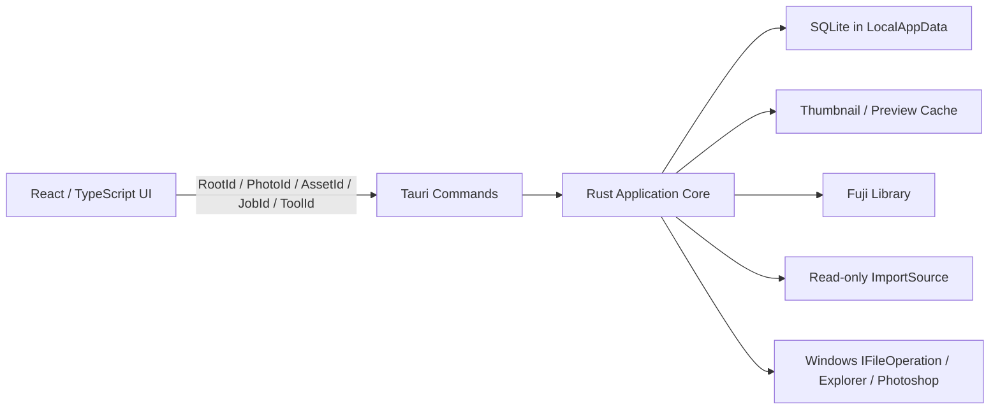

# 本地 Fuji 照片管理器 v1 设计规格

- 状态：评审后重写，待用户复核
- 日期：2026-07-28
- 目标平台：Windows 10/11 x64 桌面
- 技术路线：Tauri + React/TypeScript + Rust + SQLite
- 使用方式：单用户、本机、自用

## 1. 背景与风险声明

用户的 Fuji 图库位于约 1 TB 的机械硬盘，实际可用容量约 900 GB，当前照片数据可能只在电脑或内存卡中保留一份。Fuji 相机同时生成 JPG/JPEG 与 RAF；二者可能位于同一目录，也可能分别位于日期目录与 `raw` 子目录。历史目录结构不完全统一。

v1 解决三个直接问题：

1. 在不整理或修改历史文件的前提下浏览现有 Fuji 图库。
2. 从用户指定的内存卡文件夹安全导入，仅复制尚未导入的照片。
3. 标记不需要的逻辑照片，集中复核后移入 Windows 回收站。

本应用必须把“避免因软件缺陷、误操作、崩溃或普通外部变化而损坏照片”置于功能之前。但是，应用不能把单一物理副本变成备份：Windows 回收站与 SQLite 备份均不是照片备份，机械硬盘故障、文件系统损坏或用户在应用外永久删除文件仍可能造成不可恢复的数据丢失。应用界面与文档不得宣称“照片绝不会丢失”，并应建议用户至少保留一份独立介质上的校验备份。

## 2. v1 产品目标

v1 必须实现：

1. 由用户首次绑定一个 Fuji 图库根目录，不把路径写死为 `G:` 或其他盘符。
2. 递归索引现有 JPG/JPEG/RAF，不移动、重命名、覆盖或修改历史文件。
3. 根据可靠的 EXIF 拍摄时间生成应用内年份、月份与日期时间线。
4. 快速浏览照片；v1 只用于粗筛，不承担最终对焦或细节判断。
5. 在可靠时把 JPG 与 RAF 组成一个逻辑 `Photo`，并明确显示两种格式是否存在。
6. 使用 `D` 标记或取消待删除状态，使用 `R` 在当前会话内撤销最近的标记操作。
7. 在统一待删除清单中复核；一次确认后把全部剩余项目移入 Windows 回收站。
8. 从用户指定的内存卡文件夹只读预检与导入；应用进程不得向内存卡发起写请求。
9. 利用历史导入记录与内容确认跳过内存卡中已经导入的旧照片，只复制新增内容。
10. 新照片按 EXIF 日期写入标准目录；无可靠日期时进入明确的 `Unknown-Date` 目录。
11. 通过按钮把当前 RAF 交给已配置的 Photoshop，并通过按钮在资源管理器中定位当前展示文件。
12. 支持最多 10 万个逻辑 `Photo`、20 万个物理 `Asset` 与至少 1 TB 图库。

## 3. v1 非目标

v1 不包含：

- Xiaomi、Edited、iPhone 或 iCloud 图库界面
- 多图库同时使用；底层模型只保留未来扩展能力
- “未检查 / 已检查 / 通过”状态、评分、星标或专业选片工作流
- 100% 查看、自由缩放、拖动细节或完整 RAW 解码
- 全文搜索或复杂筛选
- 手动 JPG/RAF 配对、拆分或状态合并
- 相似照片、连拍相似、AI 识图、人脸识别或地图
- 扫描和清理历史图库中已经存在的重复文件
- 自动推荐应保留哪一份照片
- 应用自建回收站、应用内恢复或永久清空
- 永久删除 API 或 Windows 回收站不可用时的降级删除
- 自动删除、移动、格式化或弹出内存卡
- 自动整理、移动或重命名现有 Fuji 图库
- 修改 EXIF、文件属性或原片内容
- 云同步、账号、多人协作或本地 Web 服务
- 抵抗同一 Windows 账户下恶意程序的主动竞态攻击
- 对突然断电、磁盘固件错误或硬件损坏作绝对耐久承诺

## 4. 不可违反的安全不变量

以下约束高于所有普通功能需求。

### 4.1 原片不变

1. 扫描、EXIF 提取、缩略图、预览、配对和时间线均不得写入现有 JPG/RAF。
2. 应用不得原地编辑 EXIF、文件内容、文件名、目录、属性或备用数据流。
3. 缓存、数据库、日志和临时预览不得写入 Fuji 图库或内存卡。
4. 已存在图库文件不得通过通用 `write`、`remove_file`、覆盖式 rename 或等价接口处理。

### 4.2 永不覆盖

1. 导入临时文件必须以唯一名称和 `CREATE_NEW` 等价语义创建。
2. 发布正式文件必须采用“目标存在则失败”的 no-replace rename。
3. 不得直接使用会替换目标的通用 `std::fs::rename` 作为导入发布实现。
4. 名称冲突只能使用预检阶段规划的新名称，或进入冲突状态；不得临时覆盖或静默改变既定计划。
5. 创建日期目录和 partial 前，从已注册 Root 逐级重新验证卷、父目录身份与 containment；任一层是 reparse point、挂载点或离开 Root 时失败。
6. 目标文件名只接受经过 Windows 保留名、备用数据流、尾随点/空格、大小写碰撞和长度检查的单个文件名，不能把前端字符串直接拼成写路径。

### 4.3 内存卡零写入

1. 用户选择内存卡中的导入文件夹，但安全边界覆盖该文件夹所在的整个卷。
2. 一旦卷作为 `ImportSource` 使用，该卷进入全局 deny-write 集合。
3. 应用不得在内存卡创建目录、临时文件、缩略图、缓存、数据库、隐藏文件或 sidecar。
4. 元数据和预览解析器必须接收 Rust 安全层已经打开的只读句柄或字节流，不得拿路径自行重新打开并产生副作用。
5. “零写入”验收定义为本应用进程不向该卷发起任何写请求；Windows、驱动或杀毒软件的系统级行为不属于应用能够绝对控制的范围。
6. 导入成功后应用也不得删除、移动或格式化源文件。

### 4.4 删除只进入 Windows 回收站

1. `D` 只改变 SQLite 中的待删除标记，不执行文件系统动作。
2. 实际删除必须经过待删除清单复核、文件数与容量确认。
3. 实际删除必须调用 Windows `IFileOperation`，明确要求 `FOFX_RECYCLEONDELETE`，并逐文件监听真实执行结果。
4. 如果 Windows 回收站不可用、文件过大而可能永久删除、目标卷不支持或系统请求永久删除，应用必须失败并停止；不得向用户提供“仍然永久删除”的选项。
5. 应用代码中不得存在用于图库 Asset 的永久删除路径。
6. Windows 回收站位于同一物理磁盘，不得在产品文案中称为备份。

### 4.5 身份与版本校验

1. 路径不是文件身份，ID 也不是授权。
2. 每次导入发布或回收操作前必须重新验证 Root、卷、相对路径、文件 ID、大小、mtime、对象版本与当前允许动作。
3. 标记待删除后，如果文件内容身份、大小、mtime 或 JPG/RAF 成员关系变化，原标记失效并要求用户重新确认。
4. Root 离线、盘符复用、文件缺失或身份不匹配时采取保守策略：不写、不覆盖、不删除、不伪造成功。

### 4.6 文件系统与 SQLite 不是一个事务

1. 文件动作与 SQLite 提交不得描述为同一个 ACID 事务。
2. 导入和回收任务必须使用持久化意图、逐文件步骤、幂等恢复和启动协调。
3. 文件系统是物理文件存在位置的事实来源；SQLite 是索引、用户标记、任务意图和操作历史的来源。
4. 应用进程崩溃后必须能够解释每个未完成步骤；断电和硬件损坏只作尽力恢复，不作绝对保证。

## 5. 支持范围与能力模型

### 5.1 支持格式

v1 只识别以下扩展名，大小写不敏感：

- `.jpg`
- `.jpeg`
- `.raf`

PNG、HEIC、PSD、视频、XMP 和其他格式不进入时间线。扫描报告必须按扩展名汇总被忽略文件的数量，避免用户误以为文件丢失。

### 5.2 Root 类型

| Root 类型 | 作用 | v1 能力 |
|---|---|---|
| `FujiLibrary` | 用户绑定的 Fuji 图库 | 扫描、读取；本机 NTFS 时允许导入创建与显式回收 |
| `ImportSource` | 用户选择的内存卡文件夹及其所在卷 | 枚举、只读打开、元数据、哈希；整个卷禁止写入 |
| `AppDataRoot` | Windows LocalAppData | SQLite、设置、日志、操作历史和数据库备份 |
| `CacheRoot` | 默认 LocalAppData 或用户选择的本地目录 | 可重建缩略图与预览缓存 |

每个 Root 保存稳定 `RootId`、规范化路径、卷身份、Root 目录文件身份、类型和能力集合。

### 5.3 可写文件系统范围

- 只有本机 NTFS `FujiLibrary` 可以执行导入和 Windows 回收站删除。
- 网络盘、UNC、SMB、exFAT、ReFS、SUBST、目录挂载点和其他文件系统在 v1 中只允许浏览，或直接拒绝注册为可写图库。
- `ImportSource` 卷不能同时作为 FujiLibrary 写入目标或 CacheRoot；源卷与导入目标卷身份相同、Root 重叠或能力冲突时拒绝执行。
- 扫描不跟随 junction、符号链接或其他 reparse point；跳过项进入扫描报告。
- 发现 NTFS hard link 时照片仍可浏览，但标记为“不支持删除”，不得进入删除批次。

### 5.4 Root 绑定与重绑定

1. Fuji 图库首次通过 Rust 原生文件夹选择器绑定，不写死盘符。
2. 盘符变化后必须由用户重新选择目录。
3. 只有卷身份和 Root 目录身份验证通过，才把新路径绑定回原 `RootId` 并继承标记、游标和索引。
4. 无法可靠证明为原图库时，必须注册为新 Root，不得继承旧状态。
5. Root 离线时保留索引和既有待删除标记，显示“离线”；禁止新增标记和执行删除，但允许显式取消既有标记，直到用户完成可靠重绑定。

## 6. 总体架构



### 6.1 React/TypeScript 界面层

界面包含：

- 图库视图
- 待删除视图
- 导入预检与进度
- 设置
- 扫描、导入和删除报告

React 不拥有通用本地文件系统或 shell 能力。会产生文件系统动作的命令只提交已解析 ID；真实路径只作为必要的只读展示数据，不能回传为写命令授权。

### 6.2 Rust 核心服务

- `RootRegistry`：Root 注册、卷身份、能力与冲突检查。
- `CatalogService`：增量扫描、稳定 Asset 身份和缺失协调。
- `MetadataService`：EXIF、尺寸、方向与 RAF 内嵌预览提取。
- `ThumbnailService`：按需生成与读取缩略图/预览缓存。
- `PairingService`：保守生成 JPG/RAF 逻辑照片关系。
- `TimelineService`：年份、月份、日期、排序和浏览游标。
- `DeletionMarkService`：待删除标记、版本绑定和会话撤销记录。
- `RecycleService`：生成删除批次并调用 Windows 回收站。
- `ImportService`：只读预检、导入去重、目标规划、复制、校验和发布。
- `ExternalToolService`：通过 ID 调用 Photoshop 或资源管理器。
- `JobRunner`：有界后台队列、进度、暂停、取消和重试。
- `Reconciler`：启动时协调未完成导入、删除报告和文件系统事实。
- `BackupService`：SQLite 一致快照与保留策略。

### 6.3 并发边界

- 应用为单实例；再次启动只激活已有窗口。
- 同一时间只允许一个会改变照片文件系统的任务：导入执行与删除执行互斥。
- 浏览、在线 Root 的标记、只读预检和缓存读取可以继续；标记写入仍串行提交。删除批次执行期间暂停 `D/R`，但不阻止只读浏览。
- 扫描、EXIF、预览和哈希使用有界 worker 队列，不得创建无上限任务。
- SQLite 采用单写者模型；每个连接启用 `foreign_keys=ON`，数据库固定使用 `journal_mode=WAL` 与 `synchronous=FULL`，所有事务都必须检查最终 `COMMIT` 结果。

## 7. 数据模型与所有权

### 7.1 主要实体

- `Library`：逻辑图库。v1 仅创建 Fuji Library，但 schema 不把 Fuji 写死在表结构中。
- `Root`：物理根目录与能力边界。
- `Asset`：一个物理 JPG/JPEG/RAF 的稳定应用身份，包含当前相对路径、卷/文件身份和扫描版本。
- `Photo`：界面展示的逻辑照片，包含一个或两个 Asset，并具有递增 `photo_version`。
- `PhotoAsset`：Photo 与 Asset 的关系及配对证据。
- `DeletionMark`：`PhotoId + photo_version + OperationId + created_at`；不存在记录即未标记。
- `ViewingCursor`：按 Library 与排序方式保存最后浏览的 `PhotoId`。
- `ImportSourceProfile`：内存卡卷身份与用户选择的默认源文件夹。
- `ImportJob`：一次已确认的导入计划。
- `ImportAssetStep`：单个源文件的身份、目标规划、临时路径、指纹与状态。
- `ImportHistory`：长期保留的源身份、内容指纹与目标 Asset 映射；它只提供候选线索，不能单独证明目标副本仍然存在。
- `DeletionBatch`：确认时冻结的全部待删除 Photo 与版本快照。
- `DeletionAssetStep`：批次中每个 Asset 的预期身份与执行结果。
- `OperationReport`：长期保留的扫描、导入与删除结果。

### 7.2 不可重建状态

至少包括：

- Root 注册与重绑定记录
- 待删除标记及其 Photo 版本
- 最后浏览位置与默认排序
- 内存卡源文件夹配置
- Photoshop `ToolId`
- 导入历史和未完成 ImportJob
- 删除批次、逐文件结果和操作报告
- 缓存目录与容量设置

### 7.3 可重建派生数据

包括：

- EXIF 解析缓存
- 缩略图与预览
- 时间线分组
- 尚未被用户标记或任务引用的自动配对候选
- 文件大小、mtime 等最近扫描快照
- 仅用于导入候选确认的内容哈希缓存
- 排序和分页辅助索引

派生数据可以选择性清空重建，但不得通过删除整个数据库的方式处理问题。

## 8. 扫描、身份与外部变化

### 8.1 启动增量扫描

1. 应用启动后先从 SQLite 展示已有索引。
2. 后台增量扫描 Fuji Root；不等待全盘扫描完成才开放浏览。
3. 扫描递归处理普通实体目录，不跟随 reparse point。
4. 只读取受支持文件的必要元数据；缩略图按视口附近优先生成。
5. 启动扫描不自动运行全图库内容哈希。
6. 界面提供“重新扫描”按钮。

### 8.2 稳定身份

- 本机 NTFS 优先使用卷身份与文件 ID 协调既有 `AssetId`。
- 文件 ID、相对路径、大小和 mtime 共同用于发现普通外部变化。
- 任何歧义都不得把旧 AssetId、待删除标记或 Photo 状态转移给新文件。
- 新发现且无法可靠匹配的文件获得新 AssetId。

### 8.3 文件缺失

- Root 整体离线：保留全部索引和标记，禁用导入执行、实际删除、Photoshop 和文件定位。`D` 只能移除已有标记，不能新增；`R` 只有在结果为移除标记时可用，任何会重新新增标记的撤销都被拒绝。
- 未标记 Photo 的全部 Asset 在在线 Root 中消失：从普通图库隐藏并保留内部墓碑。
- 已标记 Photo 的文件消失：留在待删除问题清单，显示“源文件不存在”，不能执行。
- 配对 Photo 只缺一个 Asset：继续显示剩余文件，更新 JPG/RAF 状态，并使旧删除标记失效。
- 文件重新出现且身份可靠匹配后恢复显示；不得静默恢复旧待删除标记到新身份。

## 9. 时间线与排序

### 9.1 拍摄日期

优先使用可靠的 EXIF `DateTimeOriginal`。

```text
2025
└── 09
    ├── 2025-09-14
    └── 2025-09-21
```

- 没有可靠拍摄时间的照片进入“日期未知”。
- “日期未知”始终位于时间线末尾，不随升序/降序移动到最前。
- 文件时间可在详情中显示，但不作为拍摄时间或目录规划依据。
- EXIF 没有时区时，直接使用相机记录的本地年月日，不根据电脑时区换算。

### 9.2 排序

- 默认按拍摄时间从新到旧。
- 支持切换为从旧到新。
- 拍摄时间相同时按文件名自然排序，例如 `DSCF9` 位于 `DSCF10` 前。
- 最后使用稳定 `PhotoId` 打破完全相同的排序键，保证重扫后顺序稳定。

### 9.3 浏览位置

- 按 Library 和当前排序保存最后浏览的 `PhotoId`。
- 重启后回到该 Photo。
- Photo 已删除或离线时，定位到当前排序中的最近下一张；没有下一张时使用上一张。
- 首尾不循环。

## 10. JPG/RAF 逻辑配对

### 10.1 自动配对规则

只有同时满足以下条件时才自动配对：

1. 位于同一 Library。
2. 主文件名相同，大小写不敏感。
3. 候选唯一。
4. 可读取时，`DateTimeOriginal` 相同。
5. 相机型号或序列信息存在时不得冲突。
6. 同一次导入计划中的对应 JPG/RAF 可作为额外证据。

存在歧义时宁可漏配，不得冒险错配；两个 Asset 分别形成独立 Photo。v1 不提供手动配对或拆分。

### 10.2 展示与删除单元

- JPG + RAF：显示 JPG，状态为 `JPG ✓ · RAF ✓`。
- 只有 JPG：显示 JPG，状态为 `JPG ✓ · RAF ×`。
- 只有 RAF：使用 RAF 内嵌 JPEG，状态为 `JPG × · RAF ✓`。
- RAF 内嵌预览失败：显示明确占位图，但仍允许 Photoshop 和文件定位按钮。
- `×` 只表示当前索引未发现该格式，不是错误或自动补齐任务。
- 可靠配对的 JPG/RAF 共用一个 Photo，并始终构成不可拆分的标记与删除单元。

### 10.3 配对变化

- `Photo` 成员改变时递增 `photo_version`。
- 已存在的待删除标记与旧 `photo_version` 不匹配时进入“需要重新确认”。
- 新发现的 RAF/JPG 不得静默继承旧删除决定。

## 11. 浏览与标记界面

### 11.1 两个照片视图

v1 只有：

1. **图库**：显示全部当前存在的逻辑照片，并标识待删除项。
2. **待删除**：显示全部有效标记及需要处理的标记问题。

不显示“未检查、已检查、通过、完成率”等概念。

### 11.2 三栏布局

```text
┌──────────────────────────────────────────────────────────────┐
│ ← 日期    图库 / 待删除                   升序 / 降序  导入 │
├───────────┬────────────────────────────────┬─────────────────┤
│ Filmstrip │                                │ 文件名          │
│ 单列缩略图│            当前照片            │ JPG / RAF 状态  │
│ 待删除标记│                                │ EXIF / 尺寸     │
│           │                                │ Photoshop 按钮  │
│           │                                │ 文件位置按钮    │
│           │                                │ 待删除切换按钮  │
├───────────┴────────────────────────────────┴─────────────────┤
│ 当前位置 / 总数                         待删除 Photo 数量   │
└──────────────────────────────────────────────────────────────┘
```

- 中间照片是最高视觉优先级区域，使用适应窗口预览。
- Filmstrip 使用虚拟列表，当前项保持可见。
- 待删除项显示清晰但克制的标记。
- 右栏不在按钮旁显示路径。
- 待删除复核页与导入预检允许显示相对 Fuji Root 的目录。
- v1 不显示搜索框或不可用占位按钮。

### 11.3 右侧详情

保留：

- 文件名
- `JPG ✓/× · RAF ✓/×`
- 拍摄时间、尺寸、文件容量
- 相机、镜头、光圈、快门、ISO（存在时）
- “用 Photoshop 打开 RAF”按钮
- “打开当前文件位置”按钮
- “标记待删除 / 取消待删除”按钮

### 11.4 键盘与鼠标

| 输入 | 行为 |
|---|---|
| `←` | 上一张，不改变标记 |
| `→` | 下一张，不改变标记 |
| `D` | 切换当前 Photo 的待删除标记；持久化成功后前进 |
| `R` | 撤销当前会话中最近一次成功的 `D` |
| 鼠标滚轮 | 位于照片或 Filmstrip 时切换照片；向下下一张，向上上一张 |

- `R` 支持按操作倒序多步撤销，直到本次启动的历史耗尽；不提供重做。
- `R` 撤销对应 OperationId，不作用于自动前进后的当前 Photo，并重新定位到被撤销的 Photo。
- 快捷撤销只在当前应用会话内有效；跨重启通过待删除清单取消标记。
- 同一时间只允许一个标记写操作；pending 期间暂时阻止后续标记和导航，不建立按键队列。
- 忽略 `D/R` 的操作系统 auto-repeat。
- Root 离线时，`D/R` 只能执行会移除既有标记的动作；任何会新增或恢复待删除标记的动作均拒绝。
- 删除批次正在执行时暂停全部 `D/R`，批次结束后再开放；只读浏览仍可继续。
- 输入框、原生选择器、确认框、失焦窗口和导入/删除关键弹窗打开时不触发全局快捷键。
- 鼠标位于右侧详情、导入页或复核列表时执行普通页面滚动。

### 11.5 选择规则

- 图库首尾不循环；边界输入保持当前照片并轻量提示。
- 最后一张成功标记后显示“已到末尾”。
- 待删除视图中取消标记后选择原顺序的下一张；若为末项则选择上一张；清单为空时显示空状态。
- 后台扫描或导入新增照片不得改变当前选中的 PhotoId。

## 12. Photoshop 与文件位置

### 12.1 Photoshop 配置

1. 首次点击“用 Photoshop 打开 RAF”且尚未配置时，由 Rust 打开原生文件选择器。
2. 用户选择 `Photoshop.exe`；Rust 验证为可执行文件后保存持久 `ToolId`。
3. 设置页提供“重新选择 Photoshop”。
4. React 不保存或回传可执行文件路径作为后续授权。

### 12.2 按钮行为

- JPG+RAF：Photoshop 按钮打开 RAF；文件位置按钮在资源管理器中定位 JPG。
- JPG-only：Photoshop 按钮禁用；文件位置按钮定位 JPG。
- RAF-only：Photoshop 按钮打开 RAF；文件位置按钮定位 RAF。
- 应用只负责把 RAF 作为独立参数交给 Photoshop，不监控或管理 Photoshop 保存结果。
- 必须直接调用已注册可执行文件，不经过命令行 shell 字符串拼接。

## 13. 待删除标记与 Windows 回收站

### 13.1 标记事务

1. UI 提交 `ToggleDeletionMark(PhotoId, photo_version, OperationId)`。
2. Rust 重新解析 Photo、成员 Asset、Root 和版本。
3. SQLite 在短事务中添加或移除 `DeletionMark`，并写入操作事件。
4. 事务成功后 UI 才更新并前进；失败时保持当前 Photo。
5. 该步骤不调用任何文件系统写操作。

### 13.2 待删除复核

复核页按 Photo 显示：

- 缩略图
- JPG/RAF 存在状态
- 文件名与相对目录
- 拍摄时间
- 物理文件数量
- 合计容量
- 无效标记原因，例如配对变化、文件变化、离线、缺失或 hard link

用户逐项使用 `D` 或按钮取消不需要删除的标记。点击“执行删除”时处理确认时全部剩余有效标记，不提供部分勾选执行。

### 13.3 删除批次冻结

确认对话框必须显示：

- 逻辑 Photo 数量
- 物理 JPG/RAF 文件数量
- 总容量
- “执行后应用内 R 无效，只能通过 Windows 回收站恢复”的说明

确认后创建不可变 `DeletionBatch`，保存每个 Photo 的版本、每个 Asset 的预期身份和路径。批次开始时清空会话撤销历史。

批次与全部 `DeletionAssetStep` 意图必须在调用 Shell 前提交。逐 Asset 状态为 `Prepared → Validating → Recycling → Recycled | RetryableFailed | NeedsAttention`；Photo 级 `Partial` 由成员结果推导。未定义的状态转换一律拒绝。

### 13.4 执行前校验

每个 Photo 必须同时满足：

- Fuji Root 在线且仍是已注册的本机 NTFS
- Windows 回收站可用
- Photo 版本与冻结版本相同
- 所有预期 Asset 仍属于该 Photo
- 文件身份、大小和 mtime 与冻结快照相同
- 路径仍位于 Root 内且未经过 reparse point
- Asset 不是 hard link

任一条件失败时，该 Photo 不执行并进入错误报告；其他有效 Photo 可以继续。

### 13.5 Windows 回收站执行

- 每个逻辑 Photo 使用一次独立的 `IFileOperation` 调用；配对成员在同一次调用中排队，批次按 Photo 依次执行。这样普通失败终止当前 Photo 后仍可记录并继续下一个 Photo，而 Critical 结果会停止整个批次。
- 每个输入都使用绝对规范路径；使用 `IFileOperation`，设置 `FOFX_RECYCLEONDELETE | FOF_NOERRORUI | FOFX_EARLYFAILURE | FOF_NOCONFIRMATION`。`FOF_NOCONFIRMATION` 只能与强制回收和提前失败共同使用，使应用自己的批次确认成为唯一普通确认。
- 禁止设置会向用户提供永久删除选择的 `FOF_WANTNUKEWARNING`；对正式图库 Asset 禁止使用 `SHFileOperation`、`DeleteFile`、`remove_file` 或任何永久删除降级。强制回收失败时必须直接失败。
- 通过 `IFileOperationProgressSink::PostDeleteItem` 逐 Asset 记录 `hrDelete` 和 `psiNewlyCreated`；`PerformOperations` 返回成功本身不能证明逐文件成功，并且返回后始终检查 `GetAnyOperationsAborted`。
- 只有 `hrDelete` 成功、`psiNewlyCreated` 非空、原路径已不存在且该结果成功提交 SQLite 时，才把该 Asset 记为 `Recycled`。
- `hrDelete` 失败且原身份文件仍在原位属于普通失败，可以记录后继续处理下一个 Photo。`hrDelete` 成功但 `psiNewlyCreated` 为空、源消失却缺少完整回收证据、结果互相矛盾或 SQLite 无法记录结果，都属于 `CriticalSafetyViolation / NeedsAttention`。
- 遇到 Critical 状态时，进度回调返回错误以终止剩余待执行项；不得继续处理更多原片。
- 不启用永久删除、静默接受永久删除或应用自建清空。
- JPG/RAF 在产品上是一个删除单元，但 Windows 文件系统不能保证两个文件原子移动。
- 每个物理文件记录独立执行结果。

### 13.6 部分失败

如果配对 Photo 中只有一个 Asset 成功进入回收站：

- 不自动回滚已经成功的文件。
- 不宣称整个 Photo 删除成功。
- Photo 进入“部分删除”错误报告，展示成功与失败文件。
- 用户可以重试失败项，或在 Windows 回收站手动恢复成功项。

全部预期 Asset 成功回收后，Photo 从图库和待删除清单消失，并保留最小删除报告。用户通过 Windows 回收站恢复文件后，启动或手动重扫将其作为未标记照片重新加入图库。

如果应用在 Windows 回收操作期间崩溃，重启后以源路径是否存在、已持久化批次和已落库的逐文件回调结果作保守协调。源路径消失本身不能证明文件已进入回收站；缺少完整成功证据时标记 `NeedsAttention`，停止自动重试并要求用户检查 Windows 回收站，不得伪造完成。

| 重启后观察 | 协调结果 |
|---|---|
| 已持久化 `Recycled`，原路径不存在 | 保持成功 |
| 无成功记录，原身份文件仍在原位 | `RetryableFailed`；只允许用户显式重试 |
| 无成功记录，原路径不存在 | `NeedsAttention`；不得补记成功或自动重试 |
| 原路径存在但文件身份不同 | `NeedsAttention`；绝不触碰新文件 |
| 已记录成功，但原身份文件重新出现 | 视为用户从回收站恢复；重新索引且不恢复待删除标记 |
| JPG/RAF 只有部分成功 | `Partial`；只允许重试仍在原位且身份匹配的失败项 |

## 14. 内存卡导入

### 14.1 源文件夹配置

1. 用户通过 Rust 原生选择器选择内存卡中的一个文件夹。
2. 应用递归扫描该文件夹及其子目录，但绝不越出该子树，也不扫描其他同级目录。
3. 所选相对文件夹与内存卡卷身份绑定为 `ImportSourceProfile`。
4. 再次插入同一张卡时，应用自动使用上次文件夹启动只读预检，但绝不自动复制。
5. 文件夹不存在时提示重新选择；导入页始终提供“更改源文件夹”。
6. 即使只选择子目录，deny-write 仍作用于整张内存卡卷。

### 14.2 预检流程

```text
识别内存卡与已保存源文件夹
→ 只读递归枚举 JPG/JPEG/RAF
→ 读取必要元数据与源身份
→ 判断已导入旧文件 / 新文件 / 冲突 / 无法读取
→ 规划目标日期目录与名称
→ 显示整批预检
→ 用户确认
→ 执行 ImportJob
```

v1 默认处理所选文件夹中的全部受支持文件，不提供逐文件勾选。预检分类：

- 新增
- 内容完全相同、已经导入，因此跳过
- 同名但内容不同，需要一致后缀
- 日期未知
- 无法读取或解析

少量失败不阻止其余正常文件；确认页必须突出显示失败项。

### 14.3 导入时去重

v1 只做导入时去重，不扫描历史图库重复。

用户不会在应用外重命名导入后的 Fuji 原片，因此候选查找按以下顺序缩小：

1. `ImportHistory` 中相同源身份或既有内容指纹映射。
2. 目标图库中相同原始文件名、扩展名、大小和相容拍摄时间的 Asset。
3. 预期目标路径上的既有文件。

候选条件只用于缩小 I/O，不能直接证明重复。`ImportHistory`、源身份、文件名、大小和既有哈希都不能单独导致跳过；“已经导入”必须由 FujiLibrary 中当前实际存在且可访问的目标文件证明。

只有同时满足以下条件才跳过源文件：

1. 当前目标 Asset 可访问，Root 与文件身份重新验证通过。
2. 源与目标大小相同。
3. 重新读取两端得到的完整内容哈希相同。
4. 哈希相同后源与目标逐字节一致。
5. 比较结束后源文件身份、大小和 mtime 与比较前一致。

历史记录存在但目标缺失、离线、不可读或身份变化时一律不能跳过，应把源文件重新规划为导入。目标存在但内容不同属于命名冲突。这样即使 SQLite 恢复到旧备份，也不会把内存卡上的唯一现存照片误判为已经安全复制。

v1 不承诺识别在应用外被改名的历史副本；该能力需要全图库内容索引，属于后续版本。

### 14.4 目标路径

目标 Root 由用户绑定，不写死盘符。

有可靠 EXIF 日期：

```text
FujiRoot/YYYY/YYYYMMDD/DSCF1234.JPG
FujiRoot/YYYY/YYYYMMDD/raw/DSCF1234.RAF
```

无可靠 EXIF 日期：

```text
FujiRoot/Unknown-Date/DSCF1234.JPG
FujiRoot/Unknown-Date/raw/DSCF1234.RAF
```

EXIF 没有时区时直接使用相机本地日期，不使用导入日期或电脑时区猜测。

### 14.5 名称冲突

- 目标同名且内容完全相同：跳过。
- 目标同名但内容不同：预检时规划一致后缀，例如 `DSCF1234_2.JPG` 和 `raw/DSCF1234_2.RAF`。
- 同一逻辑组始终使用一致后缀。
- 发布瞬间目标被其他程序抢占：该 Asset/组进入冲突状态，不覆盖，也不临时改用未展示的新名称。

### 14.6 空间检查

执行前计算全部新增文件容量。导入完成后目标卷必须仍至少保留：

```text
max(10 GB, 目标卷容量的 2%)
```

空间不足时阻止执行并显示缺少容量。

### 14.7 ImportJob 状态机

每个源文件使用：

```text
Planned → Copying → Verified → Published → Indexed
```

发布前可以进入 `Cancelled`、`Failed`、`AwaitingSource`、`Conflict` 或 `NeedsAttention`。`Published` 是不可回退的文件系统事实；索引提交失败时停在可协调状态，绝不能为了让数据库状态“回滚”而删除正式文件。Job 级状态至少区分 `Prepared`、`Running`、`CancelRequested`、`AwaitingSource`、`Completed`、`CompletedWithErrors` 与 `NeedsAttention`，并拒绝未定义转换。

1. **Planned**：SQLite 先持久化源卷身份、源相对路径、源文件身份、大小、mtime、内容指纹、目标 Root、最终路径，以及包含 `JobId + StepId + 随机 nonce` 的唯一 partial 相对路径。
2. **Copying**：以只读句柄读取源，使用 `CREATE_NEW` 等价语义在最终目录创建唯一 `.partial`；创建成功后立即读取并提交实际 file ID。若进程在创建与 file ID 提交之间崩溃，重启后仅凭文件名不得认领或删除该文件。
3. **Verified**：写完后先调用 `FlushFileBuffers`，再关闭写句柄；随后从目标卷重新读取完整 partial，与源核对长度、完整内容哈希和逐字节内容，并再次验证源在读取期间没有变化。只比较复制循环中累计的字节或哈希不算验证完成。
4. **Published**：重新验证已记录的 partial file ID，使用句柄级 `SetFileInformationByHandle(FILE_RENAME_INFO)` 且 `ReplaceIfExists = FALSE` 发布；目标存在时失败。成功瞬间形成受保护的正式文件。
5. **Indexed**：重新观察正式文件后，以独立 SQLite 事务建立 Asset、ImportHistory 和报告。

临时文件必须与最终文件位于同一目录，确保发布是同卷同目录 rename。临时文件不得设为 Hidden/System。

### 14.8 取消、部分完成与恢复

- partial 的“已证明归属”要求计划中已提交 `JobId + StepId + nonce + 相对路径`，并且 `CREATE_NEW` 后记录的 file ID、当前 Root、路径和 Job 状态在清理前全部重新验证通过。
- 取消只停止尚未发布的文件。只有 partial 已证明归属，且原身份源文件仍可读取或已有逐字节相同的正式副本时，才允许清理；否则保留并进入 `NeedsAttention`。
- 已发布的正式文件保留，绝不回滚。
- JPG 成功而 RAF 失败等情况显示“部分完成”；失败项可重试。
- 应用重启后发现未完成任务时先展示摘要，由用户选择“继续”或“取消”，不静默自动恢复。
- 继续前必须重新验证为同一张内存卡和同一源文件；相同盘符不足以证明身份。
- 原卡不存在或插入另一张卡时显示“等待原始内存卡”。
- 正式目标存在但身份不匹配时标记冲突，不把它视为该 Job 已发布。

恢复协调使用以下矩阵：

| 正式文件 | partial | 源文件 | 恢复行为 |
|---|---|---|---|
| 不存在 | 不存在 | 原身份匹配 | 用户确认继续后重新复制 |
| 不存在 | 已证明归属且验证完整 | 原身份匹配 | 重新校验后可发布 |
| 不存在 | 已证明归属但不完整 | 原身份匹配 | 可清理并重新复制 |
| 不存在 | 未证明归属或身份不符 | 任意 | `NeedsAttention`；不得删除或采用 |
| 内容完全匹配的正式文件存在 | 任意 | 任意 | 按物理 `Published` 事实保护并补索引；不得回滚 |
| 内容不同的正式文件存在 | 任意 | 任意 | `Conflict`；正式文件和 partial 均不覆盖 |
| 任意 | partial 存在 | 源缺失或变化 | 保留 partial，等待原卡或人工处理 |
| 数据库为 `Indexed` | 任意 | 正式文件缺失 | `Missing / NeedsAttention`；不得伪造成功 |

### 14.9 导入报告与渐进显示

报告长期保留：

- 新增文件数与容量
- 跳过的既有文件数及已有位置
- 改名冲突计划与最终结果
- 日期未知文件
- 失败与取消文件及原因

已经发布并索引的照片可以渐进加入时间线，但不得改变当前选中的 PhotoId。导入完成后不再启动独立的全图库重复检测。

## 15. 缓存、后台 I/O 与性能

### 15.1 缓存位置

- SQLite、设置、日志和操作历史固定存放在 LocalAppData。
- 缩略图和预览缓存默认位于 LocalAppData，但允许用户选择其他本地目录。
- 自选缓存目录不得位于 FujiLibrary、任何 ImportSource、数据库目录内部或 reparse point 路径。
- 更改缓存位置时清空旧缓存索引并重新生成，不搬迁旧缓存。

### 15.2 缓存容量

- 默认上限 32 GB。
- 用户可调整，绝对最大值 64 GB。
- 缓存按需增长，不预分配。
- 始终为缓存所在卷保留 `max(20 GB, 卷容量的 10%)`。
- 达到设置上限或安全余量时使用 LRU 淘汰；当前照片及附近预览优先保留。
- 设置页显示设置上限、实际占用和磁盘可用空间。

### 15.3 I/O 优先级

1. 当前照片与附近预览
2. 标记事务和分页元数据
3. 导入中当前文件
4. 增量扫描与 EXIF
5. 导入候选哈希和低优先级缓存生成

检测到用户连续浏览时暂停或强力限速后台哈希；空闲数秒后恢复。机械硬盘默认使用有限并发与顺序读取优先策略。

### 15.4 规模与性能验收

测试规模：

- 10 万个逻辑 Photo
- 20 万个 JPG/RAF Asset
- 至少 1 TB 图库

以图库位于机械硬盘、SQLite 与缓存位于 SSD 的用户实际电脑为基准：

| 指标 | v1 初始目标 |
|---|---|
| 已有索引启动到可操作 | ≤ 3 秒 |
| 缓存命中切图 | p95 ≤ 150 ms |
| 未缓存照片显示反馈 | ≤ 100 ms |
| 未缓存照片出现可用预览 | p95 ≤ 2 秒 |
| `D/R` 持久化并完成切换 | p95 ≤ 250 ms |
| 10 万 Photo 常驻内存 | ≤ 1.5 GB |
| 后台任务期间缓存切图退化 | p95 不超过空闲时 2 倍 |
| 暂停或取消后台任务响应 | ≤ 2 秒 |

原型完成后允许根据真实硬件校准，但不得把指标重新改为“明显不卡顿”等不可测描述。

## 16. SQLite 耐久性与备份

- 每个连接启用 `foreign_keys=ON`；固定使用 `journal_mode=WAL` 与 `synchronous=FULL`；关键用户状态使用短事务持久化。
- 应用保持单实例和单写者；每次事务都检查最终 `COMMIT`，不能把 SQL 语句执行成功误当成事务已经持久化。
- 待删除标记必须在 UI 前进前提交成功。
- 任务意图必须在相应文件动作前提交成功。
- 每个文件系统或 Shell 动作完成后必须先提交该 Asset 的结果；提交失败时立刻停止当前写任务，重启后进入协调，不继续处理后续照片。
- 每天首次启动时创建一次 SQLite 一致快照。
- 数据库 schema 升级前额外创建版本化快照。
- 使用 SQLite Online Backup API 或等价一致快照机制，不直接复制正在写入的数据库文件。
- 保留最近 7 个日常版本和 3 个升级前版本。
- 备份默认位于 LocalAppData 独立 Backup 目录，不包含照片或缓存。
- 导入历史、删除报告和关键操作事件长期保留，不按日期自动清理。
- 数据库备份仅保护应用状态，不得在 UI 中描述为照片备份。
- 启动完整性检查失败时进入只读安全模式，禁用导入执行和实际删除；升级前快照失败时不得升级 schema。
- 从旧备份恢复后先重新观察文件系统；不得自动重放旧删除批次，也不得覆盖、回收或清理任何无法解释的文件。

## 17. 错误处理原则

- 错误必须标明受影响的 Job、Photo 和 Asset，不只显示“操作失败”。
- 每个文件显示可读原因，例如锁定、权限、空间、源卡不匹配、身份变化、名称抢占、回收站不可用。
- 短暂占用允许少量有上限的即时重试；随后停止。
- 用户通过“重试失败项”显式重试；重试前重新执行全部身份与能力校验。
- 不进行无限自动重试。
- 文件系统动作成功、SQLite 后续记录失败时显示“等待协调”，不伪造全部成功或全部失败。
- 任何不确定状态采用保守策略：不覆盖、不永久删除、不写内存卡、不迁移旧标记。

## 18. 测试策略

### 18.1 测试隔离

- 自动测试只能使用明确创建的临时 Root 和可丢弃测试文件。
- 测试进程必须拒绝把已注册真实 Fuji Root 或 ImportSource 作为破坏性测试目标。
- 在真实图库启用导入与删除前，必须先在测试图库完成全部安全测试。

### 18.2 单元测试

- 支持格式和忽略格式汇总
- EXIF 日期、未知日期与无时区规则
- 自然排序和日期未知固定末尾
- JPG/RAF 保守配对、冲突和成员变化版本
- `DeletionMark` 与 Photo 版本绑定
- `D/R` 会话撤销栈
- Root capability、卷 deny-write 与路径 containment
- reparse point、hard link 和非 NTFS 可写拒绝
- 导入候选缩小、完整哈希和逐字节重复确认
- 目标名称一致后缀规划
- ImportJob 与 DeletionBatch 非法状态转换拒绝

### 18.3 内存卡零写入测试

- 对可丢弃测试卷执行完整预检、EXIF、RAF 预览、哈希、取消、崩溃和恢复流程。
- 使用进程级写请求审计，证明应用没有向 ImportSource 卷发起写请求。
- 流程前后比较目录树、文件内容哈希、名称和应用可观察元数据。
- 验证第三方解析器只能消费只读句柄或内存数据。

### 18.4 导入集成测试

- 真实 NTFS 临时目录中的 partial、校验和 no-replace publish
- 禁止通过 `std::fs::rename` 或覆盖式 API 发布正式文件
- 在每个文件系统动作和 SQLite 提交前后注入进程终止
- 源卡拔出、同盘符换卡、源文件读取中变化
- 目标空间不足、文件锁定、权限变化和名称抢占
- 正式文件与 partial 同时存在、身份相同/不同组合
- 在 partial 创建成功但 file ID 尚未提交等每个状态边界注入崩溃，未证明归属的 partial 不得被删除或采用
- 取消后保留已发布文件并清理可证明归属的 partial
- JPG/RAF 部分完成与失败项重试
- stale ImportHistory：目标缺失、离线、身份变化、内容变化和从旧数据库恢复；没有当前逐字节相同目标时不得跳过
- 模拟哈希相同但字节不同，验证逐字节比较拒绝误判重复
- 导入前后证明既有正式文件一个字节也未改变

### 18.5 Windows 回收站测试

- 使用可丢弃文件验证强制回收 flags 和 `PostDeleteItem`，禁止永久删除 API、警告确认和降级路径
- 回收站关闭、配额不足、文件过大、文件锁定、Shell 取消与空 `psiNewlyCreated`
- 文件身份或 Photo 版本在确认后变化
- hard link、reparse point、Root 离线与非 NTFS
- JPG 成功、RAF 失败等所有部分结果
- 在 IFileOperation 调用前、调用中、回调前后与结果提交前后注入进程终止
- 回调后 SQLite 出现 `BUSY/IOERR/FULL/CORRUPT` 时停止批次，不继续处理下一项
- 无法证明成功时进入 `NeedsAttention`，不得伪造完成
- 从 Windows 回收站恢复后重扫为未标记 Photo，并验证恢复文件内容哈希与原文件完全一致

### 18.6 UI 与性能测试

- `←/→/D/R`、鼠标滚轮与右栏按钮
- pending 时输入阻止、auto-repeat、输入框和弹窗作用域
- 图库在标记前、标记后和撤销前离线；验证离线状态不会新增或恢复待删除标记
- 待删除视图首项、中间项、末项和空清单选择
- 后台扫描和渐进导入期间当前 PhotoId 不跳动
- 10 万 Photo 虚拟 Filmstrip、分页与内存上限
- 缓存命中/未命中、后台 I/O 竞争和已确认性能指标

### 18.7 数据库恢复测试

- 每日备份与升级前备份的一致性
- 从备份恢复 Root、DeletionMark、ViewingCursor、ImportHistory、Job 和报告
- 恢复旧备份后对文件系统重新扫描，不自动删除或覆盖任何无法解释的文件

## 19. v1 交付阶段

以下阶段共同组成 v1，但每个阶段必须独立可验证：

1. **只读基础**：Root 注册、SQLite schema、扫描、EXIF、缩略图、时间线、缓存和备份。
2. **浏览闭环**：三栏 UI、Filmstrip、排序、游标、保守配对、D/R 和两个照片视图。
3. **外部工具**：Photoshop ToolId、打开 RAF 与定位当前文件。
4. **安全导入**：源文件夹配置、零写入预检、导入去重、日期规划、partial、校验、发布和恢复。
5. **集中删除**：待删除复核、冻结批次、Windows 回收站、部分失败与报告。
6. **硬化验收**：崩溃注入、写请求审计、备份恢复、1 TB/10 万 Photo 性能测试。

实现顺序不得让文件写功能早于对应的安全测试和恢复规则落地。

## 20. v1 验收条件

v1 只有同时满足以下条件才算完成：

1. 用户可以绑定现有 Fuji 图库，启动扫描不会改变任何历史 JPG/RAF 的内容、名称、属性或目录。
2. 只识别 JPG/JPEG/RAF，其他格式被忽略且有汇总报告。
3. 图库能按 EXIF 年/月/日展示；日期未知固定末尾；默认新到旧并支持升序。
4. JPG/RAF 只在候选唯一且元数据相容时配对；不确定时分开显示。
5. RAF-only 使用内嵌 JPEG，不做完整 RAW 解码。
6. 用户可用 `←/→`、鼠标滚轮、`D/R` 完成浏览、标记和当前会话多步撤销。
7. 待删除标记在前进前持久化；Photo 成员或文件身份变化时旧标记自动失效。
8. Photoshop 按钮打开 RAF；配对 Photo 的文件位置按钮定位 JPG；RAF-only 定位 RAF。
9. 待删除清单显示缩略图、格式、相对目录、文件数和容量；执行处理全部剩余有效标记。
10. 所有实际删除都强制进入 Windows 回收站；只有逐文件回收对象非空且结果已持久化才记成功，回收不可用或结果不明时立即停止，没有任何永久删除选项或降级。
11. 配对 JPG/RAF 的部分删除被明确报告，绝不伪造整个 Photo 成功。
12. 用户可选择内存卡文件夹；应用只递归该子树，同时整卷零写入。
13. 同一张卡再次插入时自动预检已保存文件夹，但复制必须再次确认。
14. 导入预检只有在图库中仍存在当前可访问且与源逐字节相同的文件时才跳过；历史记录或哈希本身不能导致跳过。
15. 新文件按 `YYYY/YYYYMMDD/` 与 `raw/` 规则发布，未知日期进入 `Unknown-Date`。
16. 正式文件绝不覆盖；通用覆盖式 rename 不得用于发布。
17. 导入取消、崩溃、拔卡和部分完成都不会回滚已发布文件或修改源卡。
18. 现有图库不被自动物理整理；只有新导入文件使用标准目录。
19. SQLite 使用确定的 FULL/WAL 耐久设置；每日与升级前一致备份可恢复关键应用状态，完整性失败时只读启动，且界面不把数据库备份描述为照片备份。
20. 在 10 万 Photo、20 万 Asset、至少 1 TB 数据规模下达到第 15.4 节性能指标。
21. 所有写功能在真实图库启用前通过内存卡零写入、既有文件不变、崩溃注入和永久删除禁止测试。

## 21. 后续版本候选

以下内容需要独立设计，不从 v1 行为隐式扩展：

- 历史图库完全重复扫描与清理
- Xiaomi、Edited 或其他 Library UI
- 手动配对与拆分
- 专业选片、评分、100% 查看和缩放
- 搜索与复杂筛选
- 可选照片备份与校验工作流
- 跨设备或云端能力
