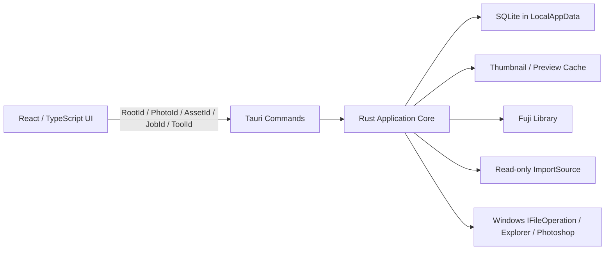

# 本地 Fuji 照片管理器 v1 设计规格

- 状态：整体架构与 v1 规格已最终确认，待按阶段实施
- 日期：2026-07-28
- 最终确认：2026-07-29
- 目标平台：Windows 10/11 x64 桌面
- 技术路线：Tauri + React/TypeScript + Rust + SQLite
- 使用方式：单用户、本机、自用

## 1. 背景与风险声明

用户的 Fuji 图库位于约 1 TB 的机械硬盘，实际可用容量约 900 GB，当前照片数据可能只在电脑或内存卡中保留一份。Fuji 相机同时生成 JPG/JPEG 与 RAF；二者可能位于同一目录，也可能分别位于日期目录与 `raw` 子目录。历史目录结构不完全统一。

v1 解决三个直接问题：

1. 在不整理或修改历史文件的前提下浏览现有 Fuji 图库。
2. 从用户指定的内存卡文件夹安全导入，仅复制尚未导入的照片。
3. 标记不需要的逻辑照片，集中复核后移入 Windows 回收站。

本应用必须把“避免因软件缺陷、误操作、崩溃或普通外部变化而损坏照片”置于功能之前。但是，应用不能把单一物理副本变成备份：Windows 回收站与 SQLite 备份均不是照片备份，机械硬盘故障、文件系统损坏或用户在应用外永久删除文件仍可能造成不可恢复的数据丢失。应用界面与文档不得宣称“照片绝不会丢失”，并应建议用户至少保留一份独立介质上的校验备份。

## 2. v1 产品目标

v1 必须实现：

1. 由用户首次绑定一个 Fuji 图库根目录，不把路径写死为 `G:` 或其他盘符。
2. 递归索引现有 JPG/JPEG/RAF，不移动、重命名、覆盖或修改历史文件。
3. 根据可靠的 EXIF 拍摄时间生成应用内年份、月份与日期时间线。
4. 快速浏览照片；v1 只用于粗筛，不承担最终对焦或细节判断。
5. 在可靠时把 JPG 与 RAF 组成一个逻辑 `Photo`，并明确显示两种格式是否存在。
6. 使用 `D` 标记或取消待删除状态，使用 `R` 在当前会话内撤销最近的标记操作。
7. 在统一待删除清单中复核；一次确认后把全部剩余项目移入 Windows 回收站。
8. 从用户指定的内存卡文件夹只读预检与导入；应用进程不得向内存卡发起写请求。
9. 利用历史导入记录与内容确认跳过内存卡中已经导入的旧照片，只复制新增内容。
10. 新照片按 EXIF 日期写入标准目录；无可靠日期时进入明确的 `Unknown-Date` 目录。
11. 通过按钮把当前 RAF 交给已配置的 Photoshop，并通过按钮在资源管理器中定位当前展示文件。
12. 支持最多 10 万个逻辑 `Photo`、20 万个物理 `Asset` 与至少 1 TB 图库。

## 3. v1 非目标

v1 不包含：

- Fuji 以外的其他图库界面
- 多图库同时使用；底层模型只保留未来扩展能力
- “未检查 / 已检查 / 通过”状态、评分、星标或专业选片工作流
- 100% 查看、自由缩放、拖动细节或完整 RAW 解码
- 全文搜索或复杂筛选
- 手动 JPG/RAF 配对、拆分或状态合并
- 相似照片、连拍相似、AI 识图、人脸识别或地图
- 扫描和清理历史图库中已经存在的重复文件
- 自动推荐应保留哪一份照片
- 应用自建回收站、应用内恢复或永久清空
- 永久删除 API 或 Windows 回收站不可用时的降级删除
- 自动删除、移动、格式化或弹出内存卡
- 自动整理、移动或重命名现有 Fuji 图库
- 修改既有图库文件或内存卡源文件的 EXIF、文件属性或原片内容；仅允许按第 14.4 节为应用新建的导入副本保留源 `LastWriteTime`
- 云同步、账号、多人协作或本地 Web 服务
- 抵抗同一 Windows 账户下恶意程序的主动竞态攻击
- 对突然断电、磁盘固件错误或硬件损坏作绝对耐久承诺

## 4. 不可违反的安全不变量

以下约束高于所有普通功能需求。

### 4.1 原片不变

1. 扫描、EXIF 提取、缩略图、预览、配对和时间线均不得写入现有 JPG/RAF。
2. 应用不得原地编辑 EXIF、文件内容、文件名、目录、属性或备用数据流。
3. 缓存、数据库、日志和临时预览不得写入 Fuji 图库或内存卡。
4. 已存在图库文件不得通过通用 `write`、`remove_file`、覆盖式 rename 或等价接口处理。

### 4.2 永不覆盖

1. 导入临时文件必须以唯一名称和 `CREATE_NEW` 等价语义创建。
2. 发布正式文件必须采用“目标存在则失败”的 no-replace rename。
3. 不得直接使用会替换目标的通用 `std::fs::rename` 作为导入发布实现。
4. 名称冲突只能使用预检阶段规划的新名称，或进入冲突状态；不得临时覆盖或静默改变既定计划。
5. 创建日期目录和 partial 前，从已注册 Root 逐级重新验证卷、父目录身份与 containment；任一层是 reparse point、挂载点或离开 Root 时失败。
6. 目标文件名只接受经过 Windows 保留名、备用数据流、尾随点/空格、大小写碰撞和长度检查的单个文件名，不能把前端字符串直接拼成写路径。

### 4.3 内存卡零写入

1. 用户选择内存卡中的导入文件夹，但安全边界覆盖该文件夹所在的整个卷。
2. 一旦卷作为 `ImportSource` 使用，该卷永久进入全局 deny-write 集合。v1 不提供解除、退休或把该策略改回可写的入口；`ImportSourceProfile` 可以停用，但卷级拒写记录只能追加，不能更新或删除。
3. 应用不得在内存卡创建目录、临时文件、缩略图、缓存、数据库、隐藏文件或 sidecar。
4. 元数据和预览解析器必须接收 Rust 安全层已经打开的只读句柄或字节流，不得拿路径自行重新打开并产生副作用。
5. “零写入”验收定义为本应用进程不向该卷发起任何写请求；Windows、驱动或杀毒软件的系统级行为不属于应用能够绝对控制的范围。
6. 导入成功后应用也不得删除、移动或格式化源文件。
7. 注册来源前必须按卷身份证明该卷不承载 `AppDataRoot`、SQLite/WAL、日志、备份、应用临时文件、任何 Active/Draining CacheRoot、当前 FujiLibrary 或其他应用必需写位置。只要无法停止本应用对候选卷的全部写入，就必须拒绝把它注册为 ImportSource；目录不重叠不能替代该卷级检查。
8. 只读身份与冲突检查通过后，必须在同一 SQLite 事务中插入或确认该卷的 `VolumePolicy` 并创建/更新 `ImportSourceProfile`；最终 COMMIT 成功前不得开始源扫描。任何 Profile 都必须有对应的永久 deny-write 行，事务失败不得留下可用 Profile。

### 4.4 删除只进入 Windows 回收站

1. `D` 只改变 SQLite 中的待删除标记，不执行文件系统动作。
2. 实际删除必须经过待删除清单复核、文件数与容量确认。
3. 实际删除必须调用 Windows `IFileOperation`，明确要求 `FOFX_RECYCLEONDELETE`，并逐文件监听真实执行结果。
4. 如果 Windows 回收站不可用、文件过大而可能永久删除、目标卷不支持或系统请求永久删除，应用必须失败并停止；不得向用户提供“仍然永久删除”的选项。
5. 应用代码中不得存在用于图库 Asset 的永久删除路径。
6. Windows 回收站位于同一物理磁盘，不得在产品文案中称为备份。

### 4.5 身份与版本校验

1. 路径不是文件身份，ID 也不是授权。
2. 每次导入发布或回收操作前必须重新验证 Root、卷、相对路径、文件 ID、大小、mtime、`asset_version`、`photo_version` 与当前允许动作。
3. `Asset` 的 Root、相对路径、文件 ID、大小、mtime 或已观察内容身份发生变化时递增 `asset_version`；Photo 的 JPG/RAF 成员关系或任一成员 `asset_version` 发生变化时递增 `photo_version`。
4. `DeletionMark` 必须冻结标记时每个成员的文件级身份快照。标记后任一成员快照或成员关系变化，原标记立即失效并要求用户重新按 `D`；应用不得把旧标记自动更新或转移到变化后的文件。
5. Root 离线、盘符复用、文件缺失或身份不匹配时采取保守策略：不写、不覆盖、不删除、不伪造成功。

### 4.6 文件系统与 SQLite 不是一个事务

1. 文件动作与 SQLite 提交不得描述为同一个 ACID 事务。
2. 导入和回收任务必须使用持久化意图、逐文件步骤、幂等恢复和启动协调。
3. 文件系统是物理文件存在位置的事实来源；SQLite 是索引、用户标记、任务意图和操作历史的来源。
4. 应用进程崩溃后必须能够解释每个未完成步骤；断电和硬件损坏只作尽力恢复，不作绝对保证。

## 5. 支持范围与能力模型

### 5.1 支持格式

v1 只识别以下扩展名，大小写不敏感：

- `.jpg`
- `.jpeg`
- `.raf`

PNG、HEIC、PSD、视频、XMP 和其他格式不进入时间线。扫描报告必须按扩展名汇总被忽略文件的数量，避免用户误以为文件丢失。

### 5.2 Root 类型

| Root 类型 | 作用 | v1 能力 |
|---|---|---|
| `FujiLibrary` | 用户绑定的 Fuji 图库 | 扫描、读取；本机 NTFS 时允许导入创建与显式回收 |
| `ImportSource` | 用户选择的内存卡文件夹及其所在卷 | 枚举、只读打开、元数据、哈希；整个卷禁止写入 |
| `AppDataRoot` | Windows LocalAppData | SQLite、设置、日志、操作历史和数据库备份 |
| `CacheRoot` | 默认 LocalAppData 或用户选择的本地目录 | 可重建缩略图与预览缓存 |

每个 Root 保存稳定 `RootId`、规范化路径、卷身份、Root 目录文件身份、类型和能力集合。

用户为缓存选择的目录只是父目录。应用必须在其中创建独占命名空间，例如 `FujiPhotoManagerCache/<CacheRootId>`；只有该命名空间内、数据库存在所有权记录且当前文件身份与记录一致的文件才可被缓存淘汰或旧缓存回收。应用不得递归清理用户选择的父目录，也不得认领或删除仅因名称相似而出现的文件。

### 5.3 可写文件系统范围

- 只有本机 NTFS `FujiLibrary` 可以执行导入和 Windows 回收站删除。
- 网络盘、UNC、SMB、exFAT、ReFS、SUBST、目录挂载点和其他文件系统在 v1 中只允许浏览，或直接拒绝注册为可写图库。
- 任何曾作为 `ImportSource` 使用的卷永久不能成为 FujiLibrary、Active/Draining CacheRoot、AppDataRoot、数据库/日志/备份/应用临时目录或其他写入目标；源卷与任一应用必需写卷身份相同、Root 重叠或能力冲突时拒绝注册和执行。
- 扫描不跟随 junction、符号链接或其他 reparse point；跳过项进入扫描报告。
- 发现 NTFS hard link 时照片仍可浏览，但标记为“不支持删除”，不得进入删除批次。

### 5.4 Root 绑定与重绑定

1. Fuji 图库首次通过 Rust 原生文件夹选择器绑定，不写死盘符。
2. 盘符变化后必须由用户重新选择目录。
3. 本机 NTFS FujiLibrary 使用卷 GUID/卷序列号与 Root 目录文件 ID 共同证明身份，盘符不参与身份判断。每次写入或回收前都从已打开目录句柄重新验证真实 Root、父子 containment，并拒绝任何 reparse 跳转。
4. 只有卷身份和 Root 目录身份验证通过，才把新路径绑定回原 `LibraryId + RootId` 并继承标记、游标、索引与历史；该情形称为原图库重连。
5. 无法可靠证明为任何已知 Root 时，必须在一个原子配置事务中创建新的 `Library + FujiLibrary Root`，把旧当前 Library 变为 Inactive，并把新 Library 设为唯一 Current/Active Library 后重新扫描。旧图库状态完整保留但不迁移、不复制、不合并；不得仅因盘符、卷标、目录名或路径相似而继承。以后可靠重连某个已知 Root 时，可以重新激活它原有的 Library，但 v1 同一时间仍只展示一个当前 Library。
6. ImportSource 保存卷身份、文件系统类型和所选目录的卷内相对位置；系统支持时还保存目录文件 ID。无法提供稳定目录身份的内存卡不得自动认定为原卡，必须由用户重新选择并通过只读复核确认。
7. Root 离线时保留索引和既有待删除标记，显示“离线”；禁止新增标记和执行删除，但允许显式取消既有标记，直到用户完成可靠重绑定。
8. 任何 ImportJob、DeletionBatch、恢复协调或缓存切换处于未终结状态时，禁止更改 FujiLibrary、ImportSource 或 CacheRoot。任务从开始到终态固定使用启动时冻结的 Root 身份快照；限制由 Rust 强制执行，不能只依赖界面禁用。
9. FujiLibrary、ImportSource 与自选 CacheRoot 的选择或重绑定，必须相对包括固定 AppDataRoot、全部 Active/Draining CacheRoot 和永久 ImportSource deny-write 集合在内的全部 Root 执行双向不重叠、卷级写冲突、能力和未完成任务检查，并作为一个原子配置事务提交；默认位于 LocalAppData 的应用自有缓存命名空间不受“自选目录”限制，但仍受 ImportSource 卷级拒写约束。
10. ImportSource 的全部身份探测与只读复核都属于第 4.3 节的进程级零写入审计范围。

### 5.5 容量单位

产品界面继续使用用户已确认的 `GB` 文案；为了避免数据库、Rust、UI 和测试分别按十进制或二进制换算，v1 的所有安全阈值把 `1 GB` 冻结为 `1,073,741,824` 字节。必须使用以下精确常量：

```text
IMPORT_MIN_RESERVE_BYTES = 10,737,418,240   # 10 GB
CACHE_DEFAULT_BYTES      = 34,359,738,368   # 32 GB
CACHE_MAX_BYTES          = 68,719,476,736   # 64 GB
CACHE_MIN_RESERVE_BYTES  = 21,474,836,480   # 20 GB
```

百分比余量使用字节数做有检查的整数运算并向上取整到整字节，例如 `ceil(volume_bytes * 2 / 100)`；溢出、负值或无法取得可靠卷容量时按检查失败处理。数据库只保存字节数，不保存已换算的浮点 `GB`。第 1 节的“约 1 TB / 900 GB”只是用户硬盘规模描述，不参与安全计算。

## 6. 总体架构



### 6.1 React/TypeScript 界面层

界面包含：

- 图库视图
- 待删除视图
- 导入预检与进度
- 设置
- 扫描、导入和删除报告

React 不拥有通用本地文件系统或 shell 能力。会产生文件系统动作的命令只提交已解析 ID；真实路径只作为必要的只读展示数据，不能回传为写命令授权。

### 6.2 Rust 核心服务

- `RootRegistry`：Root 注册、卷身份、能力与冲突检查。
- `CatalogService`：Asset 观察与建档的唯一入口；增量扫描、导入发布和恢复协调统一调用幂等 `observe_asset`，负责稳定身份、缺失协调和防止重复建档。
- `MetadataService`：EXIF、尺寸、方向与 RAF 内嵌预览提取。
- `ThumbnailService`：按需生成与读取缩略图/预览缓存。
- `PairingService`：保守生成 JPG/RAF 逻辑照片关系。
- `TimelineService`：年份、月份、日期、排序和浏览游标。
- `DeletionMarkService`：待删除标记、版本绑定和会话撤销记录。
- `RecycleService`：生成删除批次并调用 Windows 回收站。
- `ImportService`：只读预检、导入去重、目标规划、复制、校验和发布。
- `ExternalToolService`：通过 ID 调用 Photoshop 或资源管理器。
- `JobRunner`：有界后台队列、进度、暂停、取消和重试。
- `Reconciler`：启动时协调未完成导入、删除报告和文件系统事实。
- `BackupService`：SQLite 一致快照与保留策略。

### 6.3 并发边界

- 应用为单实例；再次启动只激活已有窗口。
- 同一时间只允许一个会改变照片文件系统的任务：导入执行与删除执行互斥。
- 浏览、在线 Root 的标记、只读预检和缓存读取可以继续；标记写入仍串行提交。删除批次执行期间暂停 `D/R`，但不阻止只读浏览。
- ImportJob 与 DeletionBatch 必须为涉及的 Root、相对路径和文件身份创建持久化活动 `OperationReservation`。扫描可继续读取其他区域，但不得改变 reservation 涉及 Asset/Photo 的身份、成员或版本；任务提交结果后对这些路径执行定向重扫。
- 扫描必须忽略已由 `OperationReservation` 和文件身份共同证明归属的 `.partial`。名称相似但无法证明归属的文件不得采用或删除，应报告冲突或 `NeedsAttention`。
- 扫描、EXIF、预览和哈希使用有界 worker 队列，不得创建无上限任务。
- SQLite 采用单写者模型；每个连接启用 `foreign_keys=ON`，数据库固定使用 `journal_mode=WAL` 与 `synchronous=FULL`，所有事务都必须检查最终 `COMMIT` 结果。

### 6.4 任务状态与关闭顺序

所有 Import、Recycle 和缓存淘汰都遵守“意图先于动作、物理事实先于聚合终态、释放最后发生”的顺序：

1. 先提交不可变计划/快照、当前 Attempt 或 EvictionIntent 及其 OperationReservation；Import/Recycle 还必须在同一事务取得 FileWriteLease。COMMIT 失败时不得产生文件动作。
2. 一次只执行规格允许的单个文件系统或 Shell 动作；动作结果对应的逐文件状态与不可回退 Fact 必须在开始下一项前提交。
3. 只有全部已观察物理结果都已持久化后，才可以从子项推导并提交 Attempt、Job/Batch 和报告终态；终态 Attempt、ImportPartialCleanupFact、ImportPublishedFact、ImportIndexedFact、DeletionRecycledFact、CacheEvictionFact 与 Finalized Report 不得再更新或删除。
4. 只有终态或明确的可恢复非终态已经成功持久化后，才在受控事务中释放 OperationReservation；Import/Recycle 同时按状态机处理 FileWriteLease，缓存淘汰从不借用该全局照片写栅栏。终态/释放事务失败时保留对应占用，由启动 Reconciler 协调，不能无条件清空。
5. 用户关闭窗口或应用退出时，先停止调度新步骤，持久化 `CancelRequested` 或保持可恢复非终态，等待当前文件动作或 Shell 回调完成并提交结果，然后依次停止 COM/worker、数据库写者和进程。不得先关闭数据库再等待 `PostDeleteItem`，也不得把进程退出当成任务成功或自动释放 FileWriteLease。被操作系统强制终止时由下次启动按持久化意图协调。

## 7. 数据模型与所有权

### 7.1 主要实体

- `Library`：逻辑图库。v1 可以因用户切换到无法证明为已知 Root 的新目录而保留多个 Fuji Library 上下文，但同一时间只有一个 Current/Active Library；schema 不把 Fuji 写死在表结构中。
- `CurrentLibrary`：固定单槽位，指向 v1 当前显示的 Active Library；新图库切换和旧图库可靠重连必须与 Library 生命周期在同一事务中提交。
- `Root`：物理根目录与能力边界。
- `RootBinding`：Root 在某个时点经过验证的规范路径、卷身份、Root 目录身份和绑定版本；任务固定引用创建时的 Binding，路径变化只能追加新 Binding，不能改写旧快照。
- `Asset`：一个物理 JPG/JPEG/RAF 的稳定应用身份，包含当前相对路径、卷/文件身份、扫描版本和递增 `asset_version`。
- `Photo`：界面展示的逻辑照片，包含一个或两个 Asset，并具有递增 `photo_version`。
- `PhotoAsset`：Photo 与 Asset 的关系及配对证据。
- `DeletionMark`：`PhotoId + photo_version + OperationId + created_at` 及可空释放事实；活动视图中不存在未释放记录即未标记，历史行和原快照不硬删除。
- `DeletionMarkAssetSnapshot`：DeletionMark 创建时每个成员的 `AssetId + asset_version + 角色 + RootBindingId + 卷/文件身份 + 相对路径/path key + 大小 + mtime` 不可变快照。
- `ViewingCursor`：按 Library 与排序方式保存最后浏览的 `PhotoId` 及其稳定排序锚点。
- `ImportSourceProfile`：内存卡卷身份与用户选择的默认源文件夹。
- `VolumePolicy`：曾作为 ImportSource 使用过的卷级永久 deny-write 记录；v1 只允许插入，不允许退休、更新或删除。
- `TaskIntent`：Import 或 Recycle 写任务的持久化总意图；文件动作只能由当前非终态 Task 的有效 Attempt 发起。
- `ImportJob`：一次由用户确认创建的导入意图；首次确认在同一事务中创建 Job 与第一个 Confirmed Generation，后续计划变化只追加新 Generation，不原地改写 Job 的旧计划事实。
- `ImportPlanGeneration`：隶属于 ImportJob 的追加式计划代次；计划内容创建后不可变，首代可在首次确认事务中直接以 Confirmed 创建，后续代次只允许 `Proposed → Confirmed | Rejected`，被新代次替代的 Confirmed 再进入 `Superseded`。它冻结源快照、skip/复制分类、名称/后缀、目标路径和预计新增字节；只有当前 Confirmed 代次且全量验证结果为 Ready 时可以进入空间门。
- `ImportPlanValidation`：一次开始、继续或重试请求对当前 Confirmed Generation 的只读全量刷新结果，结果仅为 `Ready | PlanChanged | AwaitingSource | NeedsAttention`；发现计划变化时只生成新的 Proposed Generation，源缺失或身份不符时不得改写稳定 SourceItem，任何结果都不取得文件写授权。
- `ImportSpaceCheck`：某一次开始、继续或重试请求在 Ready Validation 之后形成的不可变空间检查事实；一次 Passed 结果最多授权一个 ImportAttempt。
- `ImportDuplicateProof`：一次 Validation 或一次 ImportAttemptStep 各自生成的不可变双端内容与当前路径绑定证明；执行期 proof 必须由当前 Attempt 重新完整计算，不能复用 Validation proof。
- `ImportAttempt`：一次导入执行或重试尝试；创建后 Job/Generation/Validation/SpaceCheck 与 Step 集合不可变，状态只按穷举生命周期推进，终态后整行不可改写。
- `ImportAssetStep`：某个 Plan Generation 中单个源文件的不可变分类、最终目标规划、partial 命名空间/seed 与计划字节；它不冻结某一次物理 partial 的精确路径。
- `ImportAttemptStep`：某次 Attempt 对一个 ImportAssetStep 的执行状态、错误、警告和事实引用；同一计划 Step 在不同 Attempt 中拥有独立行。
- `ImportHistory`：长期保留的源身份、内容指纹与目标 Asset 映射；它只提供候选线索，不能单独证明目标副本仍然存在。
- `DeletionBatch`：确认时冻结的全部待删除 Photo 与版本快照。
- `DeletionAttempt`：一次回收执行或剩余项重试尝试；创建后 Batch 与待处理 Asset 集合不可变，状态只按穷举生命周期推进，终态后整行不可改写。
- `DeletionBatchAsset`：批次中每个 Asset 对原 DeletionMarkAssetSnapshot 的不可变引用或精确副本。
- `DeletionAttemptAsset`：某次 DeletionAttempt 对仍待处理 BatchAsset 的验证、Shell 回调证据与逐文件结果。
- `OperationReservation`：对 Root、相对路径与文件身份的协调占用；owner 必须二选一为当前 TaskAttempt 或 CacheEvictionIntent，活动唯一约束跨两种 owner 生效。
- `FileWriteLease`：Import/Recycle 共用的全局单槽位、带只递增 generation 的照片文件写栅栏；TaskAttempt、Lease generation 与其全部 OperationReservation 必须在同一事务中取得，旧 worker 或旧 generation 不得继续动作。缓存淘汰由自身 Intent 与 OperationReservation 排他，不使用该 Lease。
- `OperationReport`：长期保留、不可改写事实的扫描、导入与删除结果；后续尝试或问题解决以新 Attempt/Resolution Event 追加。
- `ImportPartialOwnership` / `ImportPartialClaim`：前者表示某个 Plan Step 的一次物理 partial incarnation，永久记录 ordinal、nonce、全历史唯一相对路径，以及哪个最初 AttemptStep 以 CREATE_NEW 创建了该对象；后者表示当前 Running AttemptStep 在当前 Lease/OperationReservation 下对它的唯一活动接管。安全清理一个不完整 incarnation 后，新 Attempt 可在同一 Confirmed Generation 下创建新 ordinal/nonce/path；恢复完整 Owned incarnation 则只创建 Takeover Claim，不能改写 Ownership 或旧 Claim。
- `ImportPartialCleanupFact`：只有当前 Takeover Claim 已提交 CleaningOwnedPartial 意图，并经同一已验证句柄完成清理或在该意图之后观察到缺失时才追加的不可回退事实；它与 Ownership=Cleaned、Step/Claim/Reservation 关闭原子提交。
- `VerifiedPartialSnapshot`：当前 Claim 对 partial 完整重读验证并设置文件时间后取得的 RootBinding、路径、文件 ID、大小、mtime 和完整内容哈希快照；它属于本次验证的 ImportAttemptStep，只能授权该 Attempt 中仍由同一打开对象执行的 no-replace 发布。
- `ImportPublishIntent`：no-replace rename 前先提交的发布意图，绑定当前 ImportAttemptStep、PartialClaim、本次 VerifiedPartialSnapshot、当前 FinalPath OperationReservation 与 FileWriteLease generation；旧 Attempt 的 Claim、快照或意图不能授权新 Attempt 发布。
- `ImportPublishedFact` / `ImportIndexedFact`：no-replace 发布成功及后续观察建档成功的不可回退物理事实；索引失败不能删除或改写 ImportPublishedFact。
- `DeletionRecycledFact`：只有逐文件 Shell 证据、原路径消失与结果 COMMIT 全部成立时才追加的不可回退回收事实。
- `CacheRootOwnership`：Active 或 Draining 缓存专属目录的 Root、命名空间和所有权证据。
- `CacheEntry`：单个可重建缓存文件的一次物理 incarnation 与所有权记录；当前可用/占用 incarnation 的渲染唯一键必须包含 `CacheRootId`，允许 Active 新 Root 与 Draining 旧 Root 同时保存同一 Asset/version 的缓存。旧 Entry 被 Evicted/Missing 后不可改写；以后重新生成使用新的 CacheEntryId、递增 incarnation ordinal 和新的全历史唯一缓存路径。
- `CacheRootCreateIntent`：创建缓存专属子目录前提交的不可变意图，冻结父目录身份与计划子目录；目录创建成功不等于可以采用，只有所有权与 Binding 事务提交后才能切换 Active Root。
- `CacheEvictionIntent`：永久删除单个已证明归属缓存前提交的意图；计划字段、身份快照及其 OperationReservation 创建后不可变，状态只按穷举生命周期推进。未知文件或无法证明的结果不能借此获得删除授权。
- `CacheEvictionFact`：Intent 之后经句柄级删除成功，或经同一冻结路径与身份链证明对象已经缺失的不可回退事实；具体 outcome 必须如实区分。

### 7.2 Schema 契约

实现 schema 前必须先提交并评审 Schema ADR，至少冻结以下约束：

- `Library → Root → Asset → PhotoAsset → Photo` 的外键、软删除与墓碑策略。
- 活动 Asset 的 `(RootId, 卷内文件身份)` 与 `(RootId, 大小写折叠规范相对路径)` 唯一性。
- 一个活动 Asset 只能属于一个活动 Photo；每个 Photo 最多拥有一个 JPG/JPEG 角色和一个 RAF 角色。
- `OperationId`、Import Group、Attempt 与 Step 的幂等键和唯一性。
- `asset_version` 与 `photo_version` 的完整递增条件。
- `Published`、`Recycled` 等物理事实不可回退；失败、重试和问题解决只能通过新 Attempt 或 `Resolved/Superseded` 生命周期表达。
- 所有会引发写入或回收的引用必须绑定不可变身份快照，不能只读取当前行后继续执行。

### 7.3 不可重建状态

至少包括：

- Root 注册与重绑定记录
- 待删除标记及其 Photo 版本
- 最后浏览位置与默认排序
- 内存卡源文件夹配置
- Photoshop `ToolId`
- 永久 VolumePolicy、CurrentLibrary 与全部 RootBinding 历史
- 导入历史、ImportPlanGeneration/Validation/SpaceCheck、ImportPartialOwnership/Claim/CleanupFact、VerifiedPartialSnapshot 和未完成 ImportJob/Attempt
- 删除标记原快照、删除批次、逐文件事实和操作报告
- 缓存目录与容量设置、CacheRootCreateIntent、CacheEntry 所有权、CacheEvictionIntent 与 CacheEvictionFact

### 7.4 可重建派生数据

包括：

- EXIF 解析缓存
- 缩略图与预览
- 时间线分组
- 尚未被用户标记或任务引用的自动配对候选
- 文件大小、mtime 等最近扫描快照
- 仅用于导入候选确认的内容哈希缓存
- 排序和分页辅助索引

派生数据可以选择性清空重建，但不得通过删除整个数据库的方式处理问题。

## 8. 扫描、身份与外部变化

### 8.1 启动增量扫描

1. 应用启动后先从 SQLite 展示已有索引。
2. 后台增量扫描 Fuji Root；不等待全盘扫描完成才开放浏览。
3. 扫描递归处理普通实体目录，不跟随 reparse point。
4. 只读取受支持文件的必要元数据；缩略图按视口附近优先生成。
5. 启动扫描不自动运行全图库内容哈希。
6. 界面提供“重新扫描”按钮。

### 8.2 稳定身份

- 本机 NTFS 优先使用卷身份与文件 ID 协调既有 `AssetId`。
- 文件 ID、相对路径、大小和 mtime 共同用于发现普通外部变化；任一受保护字段发生变化都递增 `asset_version`，并在同一 Catalog 事务中递增所有受影响 Photo 的 `photo_version`。
- 任何歧义都不得把旧 AssetId、待删除标记或 Photo 状态转移给新文件。
- 新发现且无法可靠匹配的文件获得新 AssetId。
- 扫描发现活动 reservation 时只记录观察事实，不协调该范围内的 Asset/Photo；任务终结后由 `CatalogService` 定向重扫并一次性协调。

### 8.3 文件缺失

- Root 整体离线：保留全部索引和标记，禁用导入执行、实际删除、Photoshop 和文件定位。`D` 只能移除已有标记，不能新增；`R` 只有在结果为移除标记时可用，任何会重新新增标记的撤销都被拒绝。
- 未标记 Photo 的全部 Asset 在在线 Root 中消失：从普通图库隐藏并保留内部墓碑。
- 已标记 Photo 的文件消失：留在待删除问题清单，显示“源文件不存在”，不能执行。
- 配对 Photo 只缺一个 Asset：继续显示剩余文件，更新 JPG/RAF 状态，并使旧删除标记失效。
- 文件重新出现且身份可靠匹配后恢复显示；不得静默恢复旧待删除标记到新身份。

## 9. 时间线与排序

### 9.1 拍摄日期

优先使用可靠的 EXIF `DateTimeOriginal`。

```text
2025
└── 09
    ├── 2025-09-14
    └── 2025-09-21
```

- 没有可靠拍摄时间的照片进入“日期未知”。
- “日期未知”始终位于时间线末尾，不随升序/降序移动到最前。
- 详情中必须显示文件时间供参考，但明确标为文件时间；它不作为拍摄时间、时间线排序或目录规划依据。
- EXIF 没有时区时，直接使用相机记录的本地年月日，不根据电脑时区换算。

### 9.2 排序

- 默认按拍摄时间从新到旧。
- 支持切换为从旧到新。
- 拍摄时间相同时按文件名自然排序，例如 `DSCF9` 位于 `DSCF10` 前。
- 最后使用稳定 `PhotoId` 打破完全相同的排序键，保证重扫后顺序稳定。

### 9.3 浏览位置

- 按 Library 和当前排序保存最后浏览的 `PhotoId`。
- 重启后回到该 Photo。
- Photo 已删除或离线时，定位到当前排序中的最近下一张；没有下一张时使用上一张。
- 首尾不循环。

## 10. JPG/RAF 逻辑配对

### 10.1 自动配对规则

历史图库扫描只有同时满足以下条件时才自动配对：

1. 位于同一 Library。
2. 主文件名相同，大小写不敏感。
3. 候选唯一。
4. JPG/JPEG 与 RAF 两端都有可靠且完全一致的 `DateTimeOriginal`。
5. 相机型号或序列信息存在时不得冲突。

唯一的缺时例外是导入正向证据：两个文件来自同一 ImportJob、同一源目录、相同主文件名且候选唯一；此时 Import Group 可证明它们是一组。任一端拍摄时间缺失、不可解析或与另一端冲突，且没有该正向证据时，必须形成两个独立 Photo。

存在歧义时宁可漏配，不得冒险错配；v1 不提供手动配对或拆分。

### 10.2 展示与删除单元

- JPG + RAF：显示 JPG，状态为 `JPG ✓ · RAF ✓`。
- 只有 JPG：显示 JPG，状态为 `JPG ✓ · RAF ×`。
- 只有 RAF：使用 RAF 内嵌 JPEG，状态为 `JPG × · RAF ✓`。
- RAF 内嵌预览失败：显示明确占位图，但仍允许 Photoshop 和文件定位按钮。
- `×` 只表示当前索引未发现该格式，不是错误或自动补齐任务。
- 可靠配对的 JPG/RAF 共用一个 Photo，并始终构成不可拆分的标记与删除单元。

### 10.3 配对变化

- 单个 Photo 后续发现可靠配对成员时保留原 `PhotoId`，增加成员并递增 `photo_version`。
- 两个既有独立 Photo 后续确认配对时，保留 JPG 所属 `PhotoId`；原 RAF `PhotoId` 变为墓碑并仅建立导航别名。
- 配对关系失效且两个 Asset 都存在时，JPG 保留原 `PhotoId`，RAF 获得新的 `PhotoId`；如果只剩一个 Asset，剩余文件保留原 `PhotoId`。
- 任一成员变化都递增 `photo_version`，并使相关旧 `DeletionMark` 与 `DeletionMarkAssetSnapshot` 失效；新发现或拆出的 RAF/JPG 不得静默继承旧删除决定。
- PhotoId 别名只允许用于恢复浏览位置和查询历史，不得用于把旧删除标记、批次或写授权转移到新 Photo。
- 浏览游标同时保存稳定排序锚点；原 Photo 已成墓碑、删除或离线时，按锚点定位当前排序中最近的下一张，没有下一张时选择上一张。

## 11. 浏览与标记界面

### 11.1 两个照片视图

v1 只有：

1. **图库**：显示全部当前存在的逻辑照片，并标识待删除项。
2. **待删除**：显示全部有效标记及需要处理的标记问题。

应用每次启动都默认进入图库并恢复对应排序下的浏览位置，不自动打开待删除视图。待删除入口采用条件显示：有效待删除标记、需要重新确认的标记问题、`RetryableFailed`、`NeedsAttention` 或 `Partial` 中至少存在一个待处理 Photo 时，顶部显示“待删除 N”；`N` 是待删除视图中需要复核或处理的逻辑 Photo 数量。即使没有剩余有效标记，只要仍有问题项或部分失败项，入口和视图也必须保留。

待处理 Photo 数量为 0 时不显示待删除入口，也不存在可进入的空待删除页；陈旧路由或恢复状态指向该页时直接回到图库。若上次关闭应用时仍有待处理 Photo，重启后仍默认进入图库，但立即显示“待删除 N”入口。

不显示“未检查、已检查、通过、完成率”等概念。

### 11.2 三栏布局

```text
┌──────────────────────────────────────────────────────────────┐
│ ← 日期    图库 / [待删除 N]               升序 / 降序  导入 │
├───────────┬────────────────────────────────┬─────────────────┤
│ Filmstrip │                                │ 文件名          │
│ 单列缩略图│            当前照片            │ JPG / RAF 状态  │
│ 待删除标记│                                │ EXIF / 尺寸     │
│           │                                │ Photoshop 按钮  │
│           │                                │ 文件位置按钮    │
│           │                                │ 待删除切换按钮  │
├───────────┴────────────────────────────────┴─────────────────┤
│ 当前位置 / 总数                         待删除 Photo 数量   │
└──────────────────────────────────────────────────────────────┘
```

- 中间照片是最高视觉优先级区域，使用适应窗口预览。
- Filmstrip 使用虚拟列表，当前项保持可见。
- 待删除项显示清晰但克制的标记。
- 图中的 `[待删除 N]` 是条件入口；没有待处理 Photo 时整项隐藏，不保留禁用按钮或空白占位。
- 右栏不在按钮旁显示路径。
- 待删除复核页与导入预检允许显示相对 Fuji Root 的目录。
- v1 不显示搜索框或不可用占位按钮。

### 11.3 右侧详情

图库视图右栏保留：

- 文件名
- `JPG ✓/× · RAF ✓/×`
- 拍摄时间、尺寸、文件容量
- 相机、镜头、光圈、快门、ISO（存在时）
- “用 Photoshop 打开 RAF”按钮
- “打开当前文件位置”按钮
- “标记待删除 / 取消待删除”按钮

待删除视图复用文件名、JPG/RAF 状态、拍摄信息和相对目录，但只提供“取消当前待删除”和整批“执行删除”入口；不显示 Photoshop 或文件位置按钮。

### 11.4 键盘与鼠标

| 输入 | 行为 |
|---|---|
| `←` | 上一张，不改变标记 |
| `→` | 下一张，不改变标记 |
| `D` | 切换当前 Photo 的待删除标记；成功新增标记或取消非末项后前进，取消最后一个待处理项时按第 11.5 节返回图库 |
| `R` | 撤销当前会话中最近一次成功的 `D` |
| 鼠标滚轮 | 位于照片或 Filmstrip 时切换照片；向下下一张，向上上一张 |

- `R` 支持按操作倒序多步撤销，直到本次启动的历史耗尽；不提供重做。
- `R` 撤销对应 OperationId，不作用于自动前进后的当前 Photo，并重新定位到被撤销的 Photo。
- 快捷撤销只在当前应用会话内有效；跨重启通过待删除清单取消标记。
- 同一时间只允许一个标记写操作；pending 期间暂时阻止后续标记和导航，不建立按键队列。
- 忽略 `D/R` 的操作系统 auto-repeat。
- Root 离线时，`D/R` 只能执行会移除既有标记的动作；任何会新增或恢复待删除标记的动作均拒绝。
- 删除批次正在执行时暂停全部 `D/R`，批次结束后再开放；只读浏览仍可继续。
- 输入框、原生选择器、确认框、失焦窗口和导入/删除关键弹窗打开时不触发全局快捷键。
- 鼠标位于右侧详情、导入页或复核列表时执行普通页面滚动。

### 11.5 选择规则

- 图库首尾不循环；边界输入保持当前照片并轻量提示。
- 最后一张成功标记后显示“已到末尾”。
- 待删除视图中取消标记后，如果仍有待处理 Photo，选择原顺序的下一张；若为末项则选择上一张。
- 取消最后一个待处理标记使数量从 1 变为 0 时，立即回到图库、隐藏待删除入口，并在图库中定位到刚取消标记的 Photo；若该 Photo 因缺失或离线已不可浏览，则使用当前排序中最近的下一张，没有下一张时选择上一张；不短暂显示空状态。
- 删除批次完成且最后一个待处理 Photo 已全部成功回收时，立即回到图库、隐藏待删除入口，并定位到当前排序中被删除位置的最近下一张；没有下一张时选择上一张。
- 删除结果仍有问题项、`RetryableFailed`、`NeedsAttention` 或 `Partial` 时数量不归零，待删除入口与当前复核页保持可见，不因有效标记已经耗尽而返回图库。
- 后台扫描或导入新增照片不得改变当前选中的 PhotoId。

## 12. Photoshop 与文件位置

### 12.1 Photoshop 配置

1. 首次点击“用 Photoshop 打开 RAF”且尚未配置时，由 Rust 打开原生文件选择器。
2. 用户选择 `Photoshop.exe`；Rust 验证为可执行文件后保存持久 `ToolId`。
3. 设置页提供“重新选择 Photoshop”。
4. React 不保存或回传可执行文件路径作为后续授权。

### 12.2 按钮行为

以下按钮只显示在图库视图，不显示在待删除视图：

- JPG+RAF：Photoshop 按钮打开 RAF；文件位置按钮在资源管理器中定位 JPG。
- JPG-only：Photoshop 按钮禁用；文件位置按钮定位 JPG。
- RAF-only：Photoshop 按钮打开 RAF；文件位置按钮定位 RAF。
- 应用只负责把 RAF 作为独立参数交给 Photoshop，不监控或管理 Photoshop 保存结果。
- 必须直接调用已注册可执行文件，不经过命令行 shell 字符串拼接。

## 13. 待删除标记与 Windows 回收站

### 13.1 标记事务

1. UI 提交 `ToggleDeletionMark(PhotoId, photo_version, OperationId)`。
2. Rust 重新解析 Photo、成员 Asset、Root、`photo_version` 和每个 `asset_version`。
3. SQLite 在同一个短事务中新增 `DeletionMark` 或软释放当前活动标记；新增时同时写入全部不可变 `DeletionMarkAssetSnapshot` 和操作事件，取消时写入释放时间、释放 OperationId 与原因，不硬删除原行或快照。
4. 事务成功后 UI 才更新，并按第 11.5 节决定前进或返回图库；失败时保持当前 Photo。
5. 第一个新增标记提交成功、待处理数量从 0 变为 1 时，显示“待删除 1”入口，但仍留在图库并按既有规则前进到下一张，不自动进入复核页；右栏按钮与 `D` 的行为一致。
6. 该步骤不调用任何文件系统写操作。
7. 进入待删除清单和创建删除批次时均重新验证快照。任一成员的 Root、路径、文件 ID、大小、mtime、`asset_version` 或 Photo 成员关系不一致时，标记进入“需要重新确认”，只能由用户取消后重新按 `D`；不得自动刷新快照。

### 13.2 待删除复核

复核页按 Photo 显示：

- 缩略图
- JPG/RAF 存在状态
- 文件名与相对目录
- 拍摄时间
- 物理文件数量
- 合计容量
- 无效标记原因，例如配对变化、文件变化、离线、缺失或 hard link

用户逐项使用 `D` 或按钮取消不需要删除的标记。点击“执行删除”时处理确认时全部剩余有效标记，不提供部分勾选执行。复核页不提供 Photoshop 或文件位置按钮。需要重新确认的标记问题以及未解决的 `RetryableFailed`、`NeedsAttention`、`Partial` 结果仍作为待处理 Photo 留在该页，直到用户完成相应处理；不得仅因有效标记数量为 0 而隐藏入口。

### 13.3 删除批次冻结

确认对话框必须显示：

- 逻辑 Photo 数量
- 物理 JPG/RAF 文件数量
- 总容量
- “执行后应用内 R 无效，只能通过 Windows 回收站恢复”的说明

`DeletionBatchAsset` 只能直接引用，或逐字段精确复制，创建原 `DeletionMark` 时已经提交的 `DeletionMarkAssetSnapshot`；必须保存来源 `mark_id/mark_asset_snapshot_id` 以证明该关系。创建 Batch 时重新读取文件只用于证明现场仍与原快照完全相等，绝不能生成新的身份快照、刷新旧标记或把旧授权转移到变化后的文件。任何字段不一致都使该 Photo 留在“需要重新确认”，不进入 Batch。

每个原 `DeletionMark` 在全历史中最多被一个 Batch 消费；进入 Batch 后的普通失败、部分失败和重试都只能在该 Batch 下追加新的 DeletionAttempt，不能把同一标记再次装入另一个 Batch。

确认后在一个 SQLite 事务中同时创建 `TaskIntent`、不可变 `DeletionBatch`、全部 BatchPhoto/BatchAsset、初始 `DeletionAttempt` 与逐 Asset `Prepared` 意图、Open Report、全部 Recycle Reservation，并取得新 generation 的全局 FileWriteLease。只有最终 COMMIT 成功后才能清空会话撤销历史并调用 Shell；任一插入、约束或 COMMIT 失败都不得留下可执行批次，也不得产生文件动作。

DeletionAttempt 的合法转换为 `Prepared → Running`、`Prepared → Cancelled | Interrupted`、`Running → Completed | CompletedWithErrors | NeedsAttention | Cancelled | Interrupted`；这些目标均为 Attempt 终态。逐 Asset 主路径为 `Prepared → Validating → Recycling → Recycled | RetryableFailed | NeedsAttention`，并允许在实际回收前进入 `Cancelled/Interrupted`、在 Recycling 中断后进入 `Interrupted`；Photo 级 `Partial` 只由成员结果推导。Batch 聚合状态使用 `Prepared → Running`，随后可进入 `CancelRequested`、`Completed`、`CompletedWithErrors`、`NeedsAttention` 或 `Cancelled`；只有用户显式重试并创建新 Attempt，`CompletedWithErrors/NeedsAttention` 才能回到 Running，`Completed/Cancelled` 为终态。未定义的状态转换一律拒绝。Batch、Attempt、快照、Reservation 和 FileWriteLease 的终结与释放遵守第 6.4 节，不能先释放后补结果。

### 13.4 执行前校验

每个 Photo 必须同时满足：

- Fuji Root 在线且仍是已注册的本机 NTFS
- Windows 回收站可用
- Photo 版本与冻结版本相同
- 所有预期 Asset 仍属于该 Photo
- 每个 `asset_version`、文件身份、大小和 mtime 与冻结快照相同
- 路径仍位于 Root 内且未经过 reparse point
- Asset 不是 hard link

任一条件失败时，该 Photo 不执行并进入错误报告；其他有效 Photo 可以继续。

### 13.5 Windows 回收站执行

- 每个逻辑 Photo 使用一次独立的 `IFileOperation` 调用；配对成员在同一次调用中排队，批次按 Photo 依次执行。这样普通失败终止当前 Photo 后仍可记录并继续下一个 Photo，而 Critical 结果会停止整个批次。
- 调用每个 Photo 的 `IFileOperation` 前，必须先提交本次 Attempt 对仍待处理 BatchAsset 的 `Validating/Recycling` 意图并再次完成身份校验；该提交失败时不得调用 Shell。
- 每个输入都使用绝对规范路径；使用 `IFileOperation`，设置 `FOFX_RECYCLEONDELETE | FOF_NOERRORUI | FOFX_EARLYFAILURE | FOF_NOCONFIRMATION`。`FOF_NOCONFIRMATION` 只能与强制回收和提前失败共同使用，使应用自己的批次确认成为唯一普通确认。
- 禁止设置会向用户提供永久删除选择的 `FOF_WANTNUKEWARNING`；对正式图库 Asset 禁止使用 `SHFileOperation`、`DeleteFile`、`remove_file` 或任何永久删除降级。强制回收失败时必须直接失败。
- 通过 `IFileOperationProgressSink::PostDeleteItem` 逐 Asset 记录 `hrDelete` 和 `psiNewlyCreated`；`PerformOperations` 返回成功本身不能证明逐文件成功，并且返回后始终检查 `GetAnyOperationsAborted`。
- `PostDeleteItem` 是逐文件耐久提交屏障：回调必须同步等待该 Asset 的结果行以及满足条件时的不可回退 `DeletionRecycledFact` 完成最终 SQLite COMMIT，只有提交成功后才可向 Shell 返回继续。不得把回调结果异步排队后先返回 `S_OK`；DB writer 也不得反向等待 COM worker，避免死锁。
- 只有 `hrDelete` 成功、`psiNewlyCreated` 非空、原路径已不存在且上述逐文件结果与 Fact 已成功提交 SQLite 时，才把该 Asset 记为 `Recycled`。COMMIT 失败时回调返回错误，立即停止当前 `IFileOperation` 和整个批次；已经发生但未能记录的物理结果留给 Reconciler，不能继续移动下一份原片。
- `hrDelete` 失败且原身份文件仍在原位属于普通失败，可以记录后继续处理下一个 Photo。`hrDelete` 成功但 `psiNewlyCreated` 为空、源消失却缺少完整回收证据、结果互相矛盾或 SQLite 无法记录结果，都属于 `CriticalSafetyViolation / NeedsAttention`。
- 遇到 Critical 状态时，进度回调返回错误以终止剩余待执行项；不得继续处理更多原片。
- `IFileOperation` 不能把应用持有的校验句柄与 Shell 回收动作组成一个完全原子的事务。应用必须在 `PreDeleteItem` 或 Shell 能提供的最接近执行时点重新打开并核对 Root、文件身份与冻结快照；`PostDeleteItem` 后仍按上述回收对象和逐文件结果验证。最后校验与回收之间无法完全消除的极短普通外部变化窗口作为 v1 残余风险记录，仅在本机自用、非对抗性威胁模型内接受。
- 最后校验后若检测到文件被替换、回收对象不明或结果矛盾，立即记为 `CriticalSafetyViolation / NeedsAttention` 并终止剩余删除；不得猜测、补记成功或降级为永久删除。
- 不启用永久删除、静默接受永久删除或应用自建清空。
- JPG/RAF 在产品上是一个删除单元，但 Windows 文件系统不能保证两个文件原子移动。
- 每个物理文件记录独立执行结果。

### 13.6 部分失败

如果配对 Photo 中只有一个 Asset 成功进入回收站：

- 不自动回滚已经成功的文件。
- 不宣称整个 Photo 删除成功。
- Photo 进入“部分删除”错误报告，展示成功与失败文件。
- 用户可以重试失败项、取消剩余删除意图，或在 Windows 回收站手动恢复成功项。

全部预期 Asset 成功回收后，Photo 从图库和待删除清单消失，并保留最小删除报告。若这使最后一个待处理 Photo 消失，按第 11.5 节返回图库、隐藏待删除入口并定位最近下一张。用户通过 Windows 回收站恢复文件后，启动或手动重扫将其作为未标记照片重新加入图库。

如果应用在 Windows 回收操作期间崩溃，重启后以源路径是否存在、已持久化批次和已落库的逐文件回调结果作保守协调。源路径消失本身不能证明文件已进入回收站；缺少完整成功证据时标记 `NeedsAttention`，停止自动重试并要求用户检查 Windows 回收站，不得伪造完成。

| 重启后观察 | 协调结果 |
|---|---|
| 已持久化 `Recycled`，原路径不存在 | 保持成功 |
| 无成功记录，原身份文件仍在原位 | `RetryableFailed`；只允许用户显式重试 |
| 无成功记录，原路径不存在 | `NeedsAttention`；不得补记成功或自动重试 |
| 原路径存在但文件身份不同 | `NeedsAttention`；绝不触碰新文件 |
| 已记录成功，但原身份文件重新出现 | 视为用户从回收站恢复；重新索引且不恢复待删除标记 |
| JPG/RAF 只有部分成功 | `Partial`；只允许重试仍在原位且身份匹配的失败项 |

问题项采用以下处理规则：

- `RetryableFailed` 或 `Partial` 只保留仍在原位置且身份与冻结快照匹配的未成功 Asset。用户可选择“重试剩余文件”或“取消剩余删除”；重试前重新显示剩余物理文件数、逻辑 Photo 数和容量，并再次确认。
- `NeedsAttention` 必须先重新扫描。只有能够证明原身份文件仍在原位时才开放重试；无法证明时不得猜测物理结果，只允许取消后续删除意图并保留历史事实。
- 每次重试创建新的不可变 `DeletionAttempt` 并引用原 Batch/Step；既有成功、失败和 Shell 回调事实不得改写。取消只终止仍未执行的意图，不改写已 `Recycled` 的事实。
- 从 Windows 回收站恢复出的文件经扫描后作为普通未标记 Photo 出现，不自动重新进入任何旧 Attempt。
- 待删除入口只统计当前有效标记、需要重新确认的标记和仍待处理的问题项；全部成功或剩余意图被明确取消后自动隐藏，但长期操作报告仍保留。

## 14. 内存卡导入

### 14.1 源文件夹配置

1. 用户通过 Rust 原生选择器选择内存卡中的一个文件夹。
2. 应用递归扫描该文件夹及其子目录，但绝不越出该子树，也不扫描其他同级目录。
3. 所选相对文件夹与内存卡卷身份绑定为 `ImportSourceProfile`。
4. 再次插入同一张卡时，应用只自动识别并预填上次文件夹，不自动扫描或复制；只有用户点击“开始只读预检”后才递归扫描。
5. 文件夹不存在时提示重新选择；导入页始终提供“更改源文件夹”。
6. 即使只选择子目录，deny-write 仍作用于整张内存卡卷。

### 14.2 预检流程

```text
识别内存卡与已保存源文件夹
→ 用户点击“开始只读预检”
→ 只读递归枚举 JPG/JPEG/RAF
→ 读取必要元数据与源身份
→ 判断已导入旧文件 / 新文件 / 冲突 / 无法读取
→ 规划目标日期目录与名称
→ 形成并显示只读预检草案
→ 用户在最终确认框点击“开始导入”时原子创建不可变 ImportJob 与 Confirmed Generation N
→ 创建 ImportPlanValidation，只读刷新全部源、skip 证明、名称族、目标路径和预计新增字节
→ 若源缺失/身份不符，进入 AwaitingSource/NeedsAttention；若计划变化，形成 Proposed Generation N+1 并返回确认页
→ 用户明确确认最新 Generation，旧 Confirmed Generation 变为 Superseded；用户拒绝则 Proposed 变为 Rejected，旧 Confirmed 保持不变
→ 再次全量刷新；只有未变化的 Validation 才记为 Ready
→ 为本次开始/继续/重试请求执行唯一一次 ImportSpaceCheck
→ 通过后原子创建 Attempt / FileWriteLease / Reservations 后执行
```

v1 默认处理所选文件夹中的全部受支持文件，不提供逐文件勾选。预检分类：

- 新增
- 内容完全相同、已经导入，因此跳过
- 同名但内容不同，需要一致后缀
- 日期未知
- 无法读取

EXIF 缺失或无法解析但文件内容能够完整读取时，不属于导入失败；文件进入“日期未知”并按 `Unknown-Date` 规划。真正无法完整读取内容的文件才进入失败项。少量失败不阻止其余正常文件；确认页必须突出显示失败项。

“确认并导入…”只打开最终确认框，不创建持久任务。只有用户在该确认框点击“开始导入”时，Rust 才在一个事务中创建 `TaskIntent + ImportJob + ImportSourceItem + Confirmed ImportPlanGeneration`；这只冻结用户意图和计划，不授予文件写能力，也不创建目录或 partial。每个 `ImportPlanGeneration` 的计划内容都不可变，至少冻结全部源快照、skip/复制分类、重复候选引用、JPG/RAF 分组、日期目录、完整后缀族选择、最终目标路径、partial 命名空间/seed 以及精确预计新增字节；单次物理 partial 的 ordinal、nonce 和精确路径在执行 Attempt 中产生，不属于用户计划字段。用户拒绝后续 Proposed Generation 时只把该提案追加为 `Rejected`，不得改写或废弃仍有效的当前 Confirmed Generation。

每次开始、继续或重试都先创建不可变 `ImportPlanValidation`。Rust 必须重新枚举所有相关目标候选，重新证明每个 skip，重新验证全部来源，并重新计算分类、成员、失败项、名称、组后缀、目标路径和新增字节；不能只抽查变化时间或复用旧哈希。原卡缺失时结果为 `AwaitingSource`；源卷或稳定 SourceItem 身份不符时结果为 `NeedsAttention`，不得把 Job 静默重绑到新卡或变化后的源文件。对于仍是同一组稳定源项目的计划变化，不得继续沿用原确认；应用创建新的 Proposed Generation，清楚显示变化并返回预检确认页。用户确认新 Generation 时，在同一确认事务中把旧 Confirmed Generation 转为 Superseded、把新 Generation 转为 Confirmed 并更新 Job 指针，再对新 Confirmed Generation 做一次全量验证。只有验证结果未变化并记为 Ready，才可以进入该请求唯一的空间检查；旧 Generation、旧 Validation 和未执行 Job 保留审计关系，但不获得文件写授权。

### 14.3 导入时去重

v1 只做导入时去重，不扫描历史图库重复。

用户不会在应用外重命名导入后的 Fuji 原片，因此候选查找按以下顺序缩小：

1. `ImportHistory` 中相同源身份或既有内容指纹映射。
2. 目标图库中相同原始文件名、扩展名、大小和相容拍摄时间的 Asset。
3. 预期目标路径及同目录中应用命名规则形成的完整后缀族，例如原名、`_2`、`_3`……。规划下一个后缀前必须枚举或索引该后缀族，不能依赖 SQLite 中可能缺失或回退的历史。

候选条件只用于缩小 I/O，不能直接证明重复。`ImportHistory`、源身份、文件名、大小和既有哈希都不能单独导致跳过；“已经导入”必须由 FujiLibrary 中当前实际存在且可访问的目标文件证明。

只有同时满足以下条件才跳过源文件：

1. 源和当前目标都通过由 Rust 安全层打开的稳定只读句柄读取；句柄不授予写权限，并在证明期间拒绝 `FILE_SHARE_WRITE` 与 `FILE_SHARE_DELETE`。无法取得该稳定性时本次不能判定跳过。
2. 源与目标大小相同。
3. 重新读取两端得到的完整内容哈希相同。
4. 哈希相同后源与目标逐字节一致。
5. 比较前后两端的 `RootId + RootBindingId + volume_id + relative_path/path_key + file ID + 大小 + mtime` 均与各自起始快照一致；任一端变化都使本次证明无效。
6. 在原比较句柄仍保持打开时，必须再次从计划中的源路径和目标候选路径打开对象，并分别证明两个路径当前仍解析到各自起始快照中的 RootBinding、path key 和 file ID。稳定句柄仍能读取旧对象本身，不能替代这项“当前路径仍指向该对象”的证明。

预检得到的“已经导入，因此跳过”不是永久结论。每次 Attempt 的空间检查前按第 14.2 节刷新全部证明；真正把 Step 写成 `SkippedDuplicate` 前还必须以当前 Attempt 的稳定句柄逐项完整重做上述 1–6，包括完整哈希与逐字节比较，并提交该 AttemptStep 专属的执行期 DuplicateProof，不能只复核 file ID 或复用 Validation proof。源/目标比较句柄及两端路径重开句柄都必须继续拒绝共享写入/删除并保持到 DuplicateProof、PathBindingProof 与 SkippedDuplicate 的原子事务最终 COMMIT；COMMIT 失败时不记跳过并立即停止当前 Attempt。确认前发现目标缺失、被替换或发生变化时，必须在新 Generation 中重新规划并让用户确认。Attempt 已通过唯一空间检查后才发现变化，且该变化会增加复制文件、字节数或采用不同名称时，不得在当前 Attempt 静默扩容或改名；skip 证明失效进入 `PlanStale/NeedsAttention`，目标名称被占用进入 `Conflict`，剩余新增项通过同一 Job 下新的 Generation、用户确认和新 Attempt 处理。SQLite 历史和预检结果都只能帮助定位候选，不能单独授权跳过。

历史记录存在但目标缺失、离线、不可读或身份变化时一律不能跳过，应把源文件重新规划为导入。目标存在但内容不同属于命名冲突。这样即使 SQLite 恢复到旧备份，也不会把内存卡上的唯一现存照片误判为已经安全复制。

v1 不承诺识别在应用外被改名的历史副本；该能力需要全图库内容索引，属于后续版本。

### 14.4 目标路径

目标 Root 由用户绑定，不写死盘符。

有可靠 EXIF 日期：

```text
FujiRoot/YYYY/YYYYMMDD/DSCF1234.JPG
FujiRoot/YYYY/YYYYMMDD/raw/DSCF1234.RAF
```

无可靠 EXIF 日期：

```text
FujiRoot/Unknown-Date/DSCF1234.JPG
FujiRoot/Unknown-Date/raw/DSCF1234.RAF
```

EXIF 没有时区时直接使用相机本地日期，不使用导入日期或电脑时区猜测。

导入保留源文件名主体与扩展名的原始大小写；除第 14.6 节为冲突追加数字后缀外，不做扩展名规范化、大小写重写或其他重命名。扩展名匹配仍按大小写不敏感处理。

内容验证成功后、发布前，应用尝试把新建 partial 的 `LastWriteTime` 设置为源文件在 ImportJob 中冻结的值；不修改源文件或 EXIF。设置失败不否定已经完成的内容验证，可以继续 no-replace 发布，但 ImportAttemptStep 与报告必须记录“文件时间未保留”警告。除该时间外，不复制源 ACL、备用数据流、Hidden/System 等不必要属性。

### 14.5 JPG/RAF 导入组矩阵

- 两端都有可靠且一致的拍摄时间：作为一组进入同一日期目录，RAF 放入对应 `raw` 子目录。
- 只有一端有可靠拍摄时间：只有满足第 10.1 节的同次导入正向证据时，整组使用可靠一端的日期；否则拆成独立 Photo 分别规划。
- 两端拍摄时间可靠但冲突：不配对，分别按各自日期导入并在报告中记录冲突。
- 两端都没有可靠拍摄时间：有同次导入正向证据时一起进入 `Unknown-Date`；否则分别进入。
- 目标中 JPG 已经按第 14.3 节逐字节证明存在而 RAF 是新增时，只复制 RAF，并用本次 Import Group 正向证据与既有 JPG 配对；反向情况相同。
- 任一预期同名位置已有不同内容时，整个来件组使用同一个安全后缀，JPG 与 RAF 不得被覆盖或拆成不同后缀。

### 14.6 名称冲突

- 目标同名且内容完全相同：跳过。
- 目标同名但内容不同：预检时规划一致后缀，例如 `DSCF1234_2.JPG` 和 `raw/DSCF1234_2.RAF`。
- 同一逻辑组始终使用一致后缀。
- 规划前先检查原名与完整数字后缀族；任何候选与源逐字节相同时直接跳过，全部不同时才选择第一个当前不存在的后缀。数据库记录只用于加速枚举。
- 最终确认前必须按第 14.2 节重新枚举完整名称族；任何后缀或目标路径变化都形成新 Generation 并返回确认页，不能修改已确认 Job。
- 发布瞬间目标被其他程序抢占：该 Asset/组进入冲突状态，不覆盖，也不临时改用未展示的新名称。

### 14.7 空间检查

只有第 14.2 节的当前 Confirmed Generation 完成全部 skip 与名称刷新、重新计算精确复制集，并由不可变 Validation 证明结果仍为 Ready 后，才得到本次执行的 `planned_new_bytes`。每次开始、继续或重试请求只创建一次不可变 ImportSpaceCheck；检查在创建该 Attempt、日期目录或 partial 之前执行：

```text
目标卷可用空间 >= planned_new_bytes
                    + max(IMPORT_MIN_RESERVE_BYTES,
                          ceil(目标卷容量字节数 * 2 / 100))
```

常量与舍入规则见第 5.5 节。空间不足时记录 Insufficient 检查但不创建可执行 Attempt、日期目录或 partial，并显示缺少容量；用户主动“重新检查”会先创建新的全量 Validation，再创建新的 SpaceCheck。检查通过后，以一个事务创建 ImportAttempt、取得新 generation 的 FileWriteLease 并建立该 Attempt 的全部 Reservation；每个 Passed SpaceCheck 最多只能被一个 Attempt 引用。

执行过程中不主动重复空间检查。检查后若外部变化使原 skip 需要复制、需要更大后缀族或增加任何 `planned_new_bytes`，当前 Attempt 不得扩大计划，按第 14.3 节停止该项并回到新 Generation 的确认流程。底层写入仍返回空间不足时，立即停止创建和复制后续文件，如实记录已发布、partial、失败和未开始项；已发布正式文件不回滚，partial 仍只按第 14.9 节的归属证明规则处理。

### 14.8 ImportJob 状态机

每个源文件的正常主路径使用：

```text
Planned → Validating → SkippedDuplicate
Planned → Validating → Copying → PartialVerified → Published → Indexed
```

发布前还可以进入 `Cancelled`、`Failed`、`AwaitingSource`、`Conflict`、`PlanStale`、`NeedsAttention` 或 `Interrupted`。`SkippedDuplicate` 只表示本次 Attempt 在执行时重新完成第 14.3 节的双端重复证明；需要扩大已确认复制集或改变名称时不能使用该状态，必须结束当前 Step 并走新 Generation。恢复已证明归属的 partial 使用 `ValidatingOwnedPartial → PartialVerified → Published → Indexed`；协调已发布文件只使用 `ReconcilingPublished → Indexed`，索引失败记为 `PublishedNeedsIndex`。`Published` 是不可回退的文件系统事实，绝不能为了让数据库状态“回滚”而删除正式文件。

Job 聚合状态使用 `Prepared`、`ValidatingPlan`、`AwaitingPlanConfirmation`、`ReadyToStart`、`Running`、`CancelRequested`、`AwaitingSource`、`Completed`、`CompletedWithErrors`、`NeedsAttention` 与 `Cancelled`；`ValidatingPlan` 只读且没有文件写能力，`Completed/Cancelled` 为终态。ImportAttempt 的合法转换为 `Prepared → Running`、`Prepared → Cancelled | Interrupted`、`Running → Completed | CompletedWithErrors | AwaitingSource | NeedsAttention | Cancelled | Interrupted`；这些目标均为 Attempt 终态。终态 Attempt 永不重新进入 Running，继续、恢复或重试始终创建新 Attempt。所有未定义转换一律拒绝。

1. **Planned**：当前 Attempt 只引用用户确认且验证为 Ready 的 ImportPlanGeneration/Step。Generation 已冻结源卷身份、源相对路径、源文件身份、大小、mtime、内容指纹、目标 Root/Binding、最终路径、计划分类、预计新增字节和 partial 命名空间/seed，但不冻结单次临时文件路径。创建 Copy Attempt 的事务为该 Step 追加 `Planned` ImportPartialOwnership incarnation，分配递增 ownership ordinal、随机 nonce 和全历史唯一 partial 相对路径，并建立对应 PartialPath OperationReservation；同一 Step 存在未解决的 Planned/Owned/NeedsAttention incarnation 时不得再建一个。
2. **Copying**：以只读句柄读取源，在当前 Ownership 冻结的路径使用 `CREATE_NEW` 等价语义创建 `.partial`；创建成功后立即读取 Root/Binding/path/file ID，并在同一事务把 Ownership 置为 Owned、创建当前 AttemptStep 的 `Created` ImportPartialClaim，绑定当前 SourceRead/PartialPath/FinalPath OperationReservation 与 FileWriteLease generation。创建时大小只记录为观察值，通常为 0；它不得约束复制完成后的大小，最终大小必须与冻结源和计划预计字节一致。若进程在文件创建与该 COMMIT 之间崩溃，Planned Ownership 和未知物理文件进入 NeedsAttention，重启后不得仅凭文件名认领、删除或绕过为同一 Step 创建新 incarnation。
3. **PartialVerified**：写完后先调用 `FlushFileBuffers`，再关闭写句柄；随后从目标卷打开一个具备读取、设置文件时间和句柄级 rename 所需最小权限、且拒绝 `FILE_SHARE_WRITE` 与 `FILE_SHARE_DELETE` 的验证/发布句柄。通过该句柄重新读取完整 partial，与稳定源句柄核对长度、完整内容哈希和逐字节内容，并再次验证源路径和身份在读取期间没有变化。Ownership 创建时与当前的 Root/Binding/path/file ID 必须相同；最终大小则必须等于冻结源大小和计划预计字节，而不是等于创建时通常为 0 的观察值。只比较复制循环中累计的字节或哈希不算验证完成。随后按第 14.4 节尝试设置新副本 `LastWriteTime`，再读取实际结果并提交属于当前 Claim/AttemptStep 的不可变 `VerifiedPartialSnapshot`：Root/Binding、relative path/path key、file ID、大小、mtime、完整哈希与算法。设置时间失败只记录警告，但快照必须保存实际 mtime。
4. **Published**：保持上述同一个验证/发布句柄打开，重新验证其对象与 `VerifiedPartialSnapshot` 完全一致，并从 Root 目录句柄重新验证最终父目录、containment 和目标不存在；先提交绑定当前 AttemptStep、当前 PartialClaim、本次快照、当前 FinalPath OperationReservation 与 FileWriteLease generation 的 `ImportPublishIntent`，只有该 COMMIT 成功后才通过同一 partial 句柄调用 `SetFileInformationByHandle(FILE_RENAME_INFO)`，且 `ReplaceIfExists = FALSE`。不得关闭句柄后再按路径重开并发布。成功后从同一对象取得最终目标快照，提交不可回退 ImportPublishedFact、关闭 Intent、把 Ownership 置为 ConsumedByPublish 并释放 Claim；结果提交完成后才关闭该句柄并进入下一 Step。目标存在、句柄丢失、Intent 提交失败或任一快照变化时失败，不能重新选名或发布。
5. **Indexed**：重新观察正式文件后，以独立 SQLite 事务建立 Asset、ImportHistory、ImportIndexedFact 和报告。提交失败时保留 ImportPublishedFact 并记为 `PublishedNeedsIndex`，只能由新的 Reconcile Attempt 调用 `CatalogService.observe_asset` 补索引。

临时文件必须与最终文件位于同一目录，确保发布是同卷同目录 rename。临时文件不得设为 Hidden/System。

### 14.9 取消、部分完成、重试与恢复

- partial 的“已证明归属”要求已提交同一 Job/Generation/Step 的 `ImportPartialOwnership` incarnation、递增 ordinal、nonce、全历史唯一相对路径，并且 `CREATE_NEW` 后记录的 file ID、当前 Root、路径和 Job 状态在清理前全部重新验证通过。创建时大小不是最终大小授权。
- 取消只停止尚未发布的文件。只有 partial 已证明归属，且原身份源文件仍可读取或已有逐字节相同的正式副本时，才允许清理；否则保留并进入 `NeedsAttention`。清理必须由新 Reconcile AttemptStep 的当前 Takeover Claim 先提交 `CleaningOwnedPartial` 状态，在保持当前 Lease/OperationReservation 时通过已验证句柄删除；结果事务追加不可变 `ImportPartialCleanupFact`，如实区分 `DeleteSucceeded | ObservedMissingAfterCleaningIntent`，再把 Ownership 置为 Cleaned 并关闭 Step/Claim/Reservation。不得使用先验路径删除，崩溃协调只能沿这份已提交意图继续。
- 已发布的正式文件保留，绝不回滚。
- JPG 成功而 RAF 失败等情况显示“部分完成”；失败项可重试。
- 应用重启后发现未完成任务时先展示摘要，由用户选择“继续”或“取消”，不静默自动恢复。
- 继续前必须重新验证为同一张内存卡和同一源文件；相同盘符不足以证明身份。
- 原卡不存在或插入另一张卡时显示“等待原始内存卡”。
- 正式目标存在但身份不匹配时标记冲突，不把它视为该 Job 已发布。
- 每次重试创建新的 `ImportAttempt` 并引用原 Job 与失败 Step；其计划引用与 Step 集合创建后不可变，既有终态 Attempt、`Published`、失败和警告事实不得改写。
- 重试只处理尚未发布的 Step，并重新验证 ImportSource、源文件、目标 Root、重复证明、完整名称族和剩余预计新增字节。若会改变已确认名称或扩大复制集，必须在原 Job 下生成新的 ImportPlanGeneration、返回确认页并在用户确认后创建新的 ImportAttempt；不能修改原 Generation 或 Attempt。源卡缺失时进入 `AwaitingSource`，必须在插回且用户确认后继续。
- 已证明不完整的 Ownership 只有安全清理并提交为 Cleaned 后，下一次 Copy Attempt 才能在同一 Confirmed Generation 下为该 Step 创建新的 ownership ordinal、nonce 和全历史唯一 partial 路径。因为最终分类、名称、目标路径和计划字节未变，这不创建新 PlanGeneration，也不增加一次用户确认；Planned/Owned/NeedsAttention incarnation 未解决时禁止绕过创建下一份。
- 已发布但尚未建索引的正式文件只通过 `CatalogService.observe_asset` 重新观察并补索引，绝不再次复制、覆盖或为了协调而删除。
- 取消只停止未发布部分；已经发布的文件永久保留，报告显示部分完成。
- 崩溃或暂停会使进程失去 PartialVerified 阶段持有的句柄。旧 Attempt 必须先终结并释放旧 Claim；新的 Reconcile AttemptStep 只能为同一 Job、同一 Generation、同一逻辑 Step 已提交的 `ImportPartialOwnership` 创建唯一活动 `Takeover` Claim，在取得当前 FileWriteLease 与三类 OperationReservation 后从该 Ownership 冻结的 incarnation 路径重新打开，完成全部 Root/路径/身份/完整内容验证、设置或核对实际 mtime，并生成属于新 Claim/AttemptStep 的新 VerifiedPartialSnapshot。随后还必须为新 Attempt 提交新的 ImportPublishIntent；旧 Claim、旧快照、旧 Intent、旧 Lease generation 或旧 Reservation 都不能授权发布。

恢复协调使用以下矩阵：

| 正式文件 | partial | 源文件 | 恢复行为 |
|---|---|---|---|
| 不存在 | 不存在 | 原身份匹配 | 用户确认继续后重新复制 |
| 不存在 | 已证明归属且旧验证完整 | 原身份匹配 | 新 Reconcile Attempt 建立 Takeover Claim，重新完整验证并提交新 Snapshot/PublishIntent 后才可发布 |
| 不存在 | 已证明归属但不完整 | 原身份匹配 | 新 Reconcile Attempt 以 Takeover Claim/已提交清理状态和同一已验证句柄安全清理；后续新 Copy Attempt 使用新 Ownership ordinal/nonce/path 重新复制 |
| 不存在 | 未证明归属或身份不符 | 任意 | `NeedsAttention`；不得删除或采用 |
| 内容完全匹配的正式文件存在 | 任意 | 任意 | 按物理 `Published` 事实保护并补索引；不得回滚 |
| 内容不同的正式文件存在 | 任意 | 任意 | `Conflict`；正式文件和 partial 均不覆盖 |
| 任意 | partial 存在 | 源缺失或变化 | 保留 partial，等待原卡或人工处理 |
| 数据库为 `Indexed` | 任意 | 正式文件缺失 | `Missing / NeedsAttention`；不得伪造成功 |

### 14.10 导入报告与渐进显示

报告长期保留：

- 新增文件数与容量
- 跳过的既有文件数及已有位置
- 改名冲突计划与最终结果
- 日期未知文件
- 失败与取消文件及原因
- 每次 Attempt、未开始项、警告与仍待处理状态

已经发布并索引的照片可以渐进加入时间线，但不得改变当前选中的 PhotoId。导入完成后不再启动独立的全图库重复检测。

## 15. 缓存、后台 I/O 与性能

### 15.1 缓存位置

- SQLite、设置、日志和操作历史固定存放在 LocalAppData。
- 缩略图和预览缓存默认位于 LocalAppData，但允许用户选择其他本地父目录；实际缓存始终位于应用创建的专属 `FujiPhotoManagerCache/<CacheRootId>` 命名空间。自选位置必须能提供应用所需的稳定卷、目录和文件身份；无法可靠验证身份时拒绝注册为 CacheRoot。
- 自选缓存父目录及其专属子目录不得位于 FujiLibrary、任何 ImportSource、AppDataRoot 内部或 reparse point 路径；反向包含也必须拒绝。CacheRoot 所在卷不得是任何 ImportSource 卷。
- 当前非终态/可用 CacheEntry incarnation 的渲染唯一键必须是 `(CacheRootId, AssetId, asset_version, cache_kind, render_key)`。因此切换后 Active 新 Root 可以立即为同一 Asset/version 生成新缓存，Draining 旧 Root 仍保留原 CacheEntry 与逐文件所有权；查询优先当前 Active Root，不能为解决唯一冲突而覆盖、迁移或丢弃旧所有权记录。Entry 进入 Evicted/Missing 后，未来同一渲染键按需重建时必须以 CREATE_NEW 创建新的 CacheEntry incarnation 和新的全历史唯一相对路径；旧 Entry、Intent 与 Fact 永不复用或改写。Live 或 NeedsAttention 的旧 Entry，以及其淘汰 Intent 处于 AwaitingRoot 时，继续占用该渲染键，禁止静默生成第二份。
- 自动淘汰只允许删除专属命名空间内、数据库有所有权记录且 Root、相对路径和当前文件身份均匹配的应用缓存。无法证明归属、身份变化或越出专属目录时立即停止，不递归清理父目录中的其他内容。
- 删除单个缓存前必须在同一事务提交不可变 `CacheEvictionIntent` 及其 OperationReservation，至少冻结 EvictionId/OperationId、CacheEntryId、CacheRoot/Binding、relative path/path key、file ID、大小和所有权状态。Intent 只允许 `Prepared → Deleting | AlreadyMissing | AwaitingRoot | NeedsAttention`、`Deleting → Evicted | AlreadyMissing | AwaitingRoot | NeedsAttention`、`AwaitingRoot → Deleting | AlreadyMissing | NeedsAttention`；崩溃协调与临时离线恢复只继续同一个非终态 Intent，不得另开 ordinal。明确失败、身份异常或结果不明进入终态 `NeedsAttention` 后禁止自动创建新 Intent 或重试。
- 淘汰器从已验证的缓存专属 Root 句柄打开计划对象，只申请读取身份和 DELETE 所需的最小权限，并拒绝 `FILE_SHARE_WRITE` 与 `FILE_SHARE_DELETE`。在同一句柄上重新验证 RootBinding、containment、path key、file ID、大小、非 reparse 和 CacheEntry 所有权后，只能通过 `SetFileInformationByHandle(FileDispositionInfo/FileDispositionInfoEx)` 或等价的句柄级接口删除这个已打开对象。Disposition 成功后关闭该句柄，并从已验证父目录重新确认原计划路径不存在，才可提交 `Evicted` 与 CacheEvictionFact；若该路径已出现另一身份对象，只记录 `NeedsAttention`，绝不再次按路径删除。生产缓存路径禁止使用“先校验、再 `remove_file(path)`”或通用递归删除。
- 缓存句柄级删除的结果必须在处理下一条前提交到 EvictionIntent，并在句柄删除成功时追加 outcome=`DeleteSucceeded` 的不可变 `CacheEvictionFact`；Intent 提交后、动作前对象已经缺失且冻结路径与身份链不存在矛盾证据时，追加 outcome=`ObservedMissingAfterIntent`。Fact、Intent 终态、CacheEntry 状态与 OperationReservation 释放必须在同一事务提交；提交失败时停止淘汰并保留同一 Intent/OperationReservation 供 Reconciler 协调，不能按相同路径继续删除。路径被替换、身份不明或旧卷身份变化则进入 `NeedsAttention`，不得猜测归属或删除替代对象。
- 更改缓存位置或容量前显示影响摘要；只有用户明确确认后才生效，取消不改变任何设置。
- 创建新的缓存专属子目录前，必须先提交 `CacheRootCreateIntent`，冻结已验证父目录身份、计划子目录名与 OperationId。COMMIT 后只创建该直接子目录；成功后再以单一事务建立 Root/Binding/Ownership 并切换 Active/Draining。父身份变化、同名路径已存在或绑定事务失败时不得采用、改名或清理该目录，原设置保持有效。
- 新专属目录通过 Root、containment、冲突和可写验证并创建成功后，才原子切换 CacheRoot；切换后的新缓存只写入新位置，不搬迁旧缓存。
- 旧缓存继续保留 Root 与逐文件所有权记录，并在后台按 LRU 渐进回收。旧卷离线、Root 身份或文件身份不符时保持原样，绝不猜测删除。
- v1 不提供“手动清理缓存”。更改位置、缩小容量和正常超限都由相同的安全 LRU 淘汰器处理。

### 15.2 缓存容量

- 默认上限 32 GB，即第 5.5 节冻结的 `CACHE_DEFAULT_BYTES`。
- 用户可调整，绝对最大值 64 GB，即 `CACHE_MAX_BYTES`。
- 缓存按需增长，不预分配。
- 始终为缓存所在卷保留 `max(CACHE_MIN_RESERVE_BYTES, ceil(卷容量字节数 * 10 / 100))`。
- 达到设置上限或安全余量时使用 LRU 淘汰；当前照片及附近预览优先保留。
- 缩小容量后采用后台渐进淘汰，不要求设置页同步等待大量删除。
- 设置页显示设置上限、实际占用和磁盘可用空间。

### 15.3 I/O 优先级

1. 当前照片与附近预览
2. 标记事务和分页元数据
3. 导入中当前文件
4. 增量扫描与 EXIF
5. 导入候选哈希和低优先级缓存生成

检测到用户连续浏览时暂停或强力限速后台哈希；空闲数秒后恢复。机械硬盘默认使用有限并发与顺序读取优先策略。

### 15.4 规模与性能验收

测试规模：

- 10 万个逻辑 Photo
- 20 万个 JPG/RAF Asset
- 至少 1 TB 图库

以图库位于机械硬盘、SQLite 与缓存位于 SSD 的用户实际电脑为基准：

| 指标 | v1 初始目标 |
|---|---|
| 已有索引启动到可操作 | ≤ 3 秒 |
| 缓存命中切图 | p95 ≤ 150 ms |
| 未缓存照片显示反馈 | ≤ 100 ms |
| 未缓存照片出现可用预览 | p95 ≤ 2 秒 |
| `D/R` 持久化并完成切换 | p95 ≤ 250 ms |
| 10 万 Photo 常驻内存 | ≤ 1.5 GB |
| 后台任务期间缓存切图退化 | p95 不超过空闲时 2 倍 |
| 暂停或取消后台任务响应 | ≤ 2 秒 |

原型完成后允许根据真实硬件校准，但不得把指标重新改为“明显不卡顿”等不可测描述。

## 16. SQLite 耐久性与备份

- 每个连接启用 `foreign_keys=ON`；固定使用 `journal_mode=WAL` 与 `synchronous=FULL`；关键用户状态使用短事务持久化。
- 应用保持单实例和单写者；每次事务都检查最终 `COMMIT`，不能把 SQL 语句执行成功误当成事务已经持久化。
- 每个连接设置有界 `busy_timeout`；应用执行受控 WAL checkpoint，扫描和报告查询不得持有无界长读事务。
- AppDataRoot 空间不足、SQLite `FULL/IOERR/CORRUPT` 或耐久提交失败时关闭 Import/Recycle，保留可读报告并进入明确的安全状态，不继续新的照片文件动作。
- 待删除标记必须在 UI 前进前提交成功。
- 任务意图必须在相应文件动作前提交成功。
- 每个文件系统或 Shell 动作完成后必须先提交该 Asset 的结果；提交失败时立刻停止当前写任务，重启后进入协调，不继续处理后续照片。
- Job/Batch 的聚合状态只能由已提交 Step/Fact 推导；合法状态转换由 Rust 领域层集中穷举，更新使用旧状态与行版本 CAS。非法转换、重复跨终态转换和把终态 Attempt 重新置为 Running 必须失败。
- 终态 Attempt、ImportPartialCleanupFact、ImportPublishedFact、ImportIndexedFact、DeletionRecycledFact、CacheEvictionFact、Finalized Report、VolumePolicy 和已完成 CacheEvictionIntent 的事实行只追加且禁止 UPDATE/DELETE；非终态 Attempt 只允许通过带旧状态与行版本 CAS 的合法转换推进。终态、报告最终化、OperationReservation/FileWriteLease 释放及定向重扫严格遵守第 6.4 节的提交与关闭顺序。
- 每天首次启动时创建一次 SQLite 一致快照。
- 数据库 schema 升级前额外创建版本化快照。
- 使用 SQLite Online Backup API 或等价一致快照机制，不直接复制正在写入的数据库文件。
- 保留最近 7 个日常版本和 3 个升级前版本。
- 备份默认位于 LocalAppData 独立 Backup 目录，不包含照片或缓存。
- 导入历史、删除报告和关键操作事件长期保留，不按日期自动清理。
- 数据库备份仅保护应用状态，不得在 UI 中描述为照片备份。
- 启动完整性检查失败时进入只读安全模式，禁用导入执行和实际删除；升级前快照失败时不得升级 schema。
- 从旧备份恢复后先重新观察文件系统；不得自动重放旧删除批次，也不得覆盖、回收或清理任何无法解释的文件。

## 17. 报告、恢复入口与错误处理

### 17.1 报告与恢复入口

- 图库与条件显示的待删除仍是仅有的两个照片视图；顶栏不增加常驻“报告”页签。
- 导入完成后直接显示本次导入报告，用户可返回图库或再次导入。
- 删除全部成功时按第 11.5 节返回图库，并提供一次不打断浏览的“查看报告”入口；仍有问题时保留在待删除页并显示本次逐文件结果。
- 历史扫描、导入和删除报告统一从设置页“操作记录”进入并长期保留。
- 报告中的物理事实不可编辑为成功；后续重试、取消剩余意图或问题解决只能追加新的 Attempt/Resolution Event，并保留原始结果和关联关系。
- 应用启动发现未终结 ImportJob、DeletionBatch 或恢复协调时，先显示只读恢复摘要，由用户选择继续或取消允许取消的剩余意图；不得静默恢复任何写操作。

### 17.2 错误处理原则

- 普通界面中的错误必须用用户可核对的信息标明受影响对象，例如操作类型与开始时间、文件名、JPG/RAF 角色和用户可读相对路径，不能只显示“操作失败”。`JobId`、`PhotoId`、`AssetId`、Root/Library/Attempt/Step ID、卷 GUID、文件 ID、内容哈希、nonce、capability 和数据库状态码只允许进入开发诊断日志，不得出现在普通错误、确认框或报告中。
- 每个文件显示可读原因，例如锁定、权限、空间、源卡不匹配、身份变化、名称抢占、回收站不可用。
- 短暂占用允许少量有上限的即时重试；随后停止。
- 用户通过“重试失败项”显式重试；重试前重新执行全部身份与能力校验。
- 不进行无限自动重试。
- 文件系统动作成功、SQLite 后续记录失败时显示“等待协调”，不伪造全部成功或全部失败。
- 任何不确定状态采用保守策略：不覆盖、不永久删除、不写内存卡、不迁移旧标记。

## 18. 测试策略

### 18.1 测试隔离

- 自动测试只能使用明确创建的临时 Root 和可丢弃测试文件。
- 测试进程必须拒绝把已注册真实 Fuji Root 或 ImportSource 作为破坏性测试目标。
- 在真实图库启用导入与删除前，必须先在测试图库完成全部安全测试。

### 18.2 单元测试

- 支持格式和忽略格式汇总
- EXIF 日期、未知日期与无时区规则
- 自然排序和日期未知固定末尾
- 历史 JPG/RAF 双端可靠 EXIF 配对、导入正向证据、缺时/冲突拆分和导入组日期矩阵
- PhotoId 合并、拆分、墓碑别名、排序锚点及别名不能转移删除授权
- `asset_version`/`photo_version` 递增条件，`DeletionMarkAssetSnapshot` 对 Root、路径、文件 ID、大小和 mtime 变化的失效，以及取消标记只软释放且不删除旧快照
- `D/R` 会话撤销栈
- 待删除入口的派生可见性与计数：有效标记、标记问题、`RetryableFailed`、`NeedsAttention`、`Partial` 及零项组合
- Root capability、永久卷 deny-write、NTFS 卷/目录身份、原 Root 重连、新 Root 创建新 Library/切换 CurrentLibrary 且不继承、任务期间重绑定拒绝与路径 containment
- ImportSource 与 AppData、SQLite/WAL、日志、备份、应用临时目录、Active/Draining CacheRoot 或任何必需写卷冲突时拒绝注册；VolumePolicy/Profile 原子注册任一语句或 COMMIT 失败时不得扫描；停用 Profile 后卷级 deny-write 仍不可更新或删除
- reparse point、hard link 和非 NTFS 可写拒绝
- 导入候选缩小，以及 Validation 与真正写入 SkippedDuplicate 前两次各自独立完成的双端禁止共享写/删句柄、RootBinding/path 当前绑定复核、完整哈希、逐字节重复证明；执行阶段不得只复核身份或复用 Validation proof
- 完整数字后缀族枚举与同组一致后缀规划
- ImportPlanGeneration 计划内容不可变；每次开始/继续/重试使用新的全量 Validation，变化创建新代次，旧确认或旧 Passed SpaceCheck 不能创建多个可执行 Attempt
- 容量常量、百分比向上取整与溢出拒绝在 Rust、SQLite 和测试中使用第 5.5 节完全相同的字节值
- 当前 CacheEntry incarnation 的渲染唯一键包含 CacheRootId；Active 与 Draining Root 可同时保存同一 Asset/version 的所有权记录。Evicted/Missing 后按需重建必须创建新 Entry/ordinal/唯一路径，旧 Entry/Intent/Fact 不改写；NeedsAttention incarnation 阻止静默重复生成
- Schema ADR 中的外键、活动 Asset/Photo、角色、Operation/Attempt/Step 唯一约束
- ImportJob、ImportAttempt、DeletionBatch、DeletionAttempt 与 CacheEvictionIntent 的非法状态转换、跨终态更新和错误释放顺序拒绝

### 18.3 内存卡零写入测试

- 对可丢弃测试卷执行完整预检、EXIF、RAF 预览、哈希、取消、崩溃和恢复流程。
- 使用进程级写请求审计，证明应用没有向 ImportSource 卷发起写请求。
- 流程前后比较目录树、文件内容哈希、名称和应用可观察元数据。
- 验证第三方解析器只能消费只读句柄或内存数据。
- 停用/更换 ImportSourceProfile 后尝试把旧源卷绑定为 FujiLibrary、CacheRoot 或其他写位置必须失败；数据库备份与恢复后永久 deny-write 记录仍存在。
- 候选来源与 AppData 或任一 Active/Draining 写 Root 位于同卷时，在建立 Profile 前拒绝，且进程级观察仍为源卷零写入。

### 18.4 导入集成测试

- 真实 NTFS 临时目录中的 partial、校验和 no-replace publish
- 禁止通过 `std::fs::rename` 或覆盖式 API 发布正式文件
- 在每个文件系统动作和 SQLite 提交前后注入进程终止
- 源卡拔出、同盘符换卡、源文件读取中变化
- 目标空间不足、文件锁定、权限变化和名称抢占
- 每次开始/继续/重试只在 Ready Validation 后创建一次 SpaceCheck；旧 Passed 检查不得复用，检查后模拟空间耗尽时停止后续复制、保留已发布文件并如实报告 partial/未开始项
- 正式文件与 partial 同时存在、身份相同/不同组合
- 在 partial 创建成功但 file ID 尚未提交等每个状态边界注入崩溃，未证明归属的 partial 不得被删除或采用
- 取消后保留已发布文件并清理可证明归属的 partial
- JPG/RAF 部分完成与失败项重试
- JPG/RAF 一端已逐字节存在而另一端新增、单端日期、双端缺时、日期冲突和整组一致后缀矩阵
- EXIF 缺失/损坏但内容可读时导入 `Unknown-Date`；源 `LastWriteTime` 保留成功与失败警告，且不复制 ACL/ADS/Hidden/System
- stale ImportHistory：目标缺失、离线、身份变化、内容变化、完整后缀族中的旧副本和从旧数据库恢复；没有当前逐字节相同目标时不得跳过
- 在预检重复证明后、ImportAttempt 执行前替换或删除目标，验证必须重新规划而非沿用跳过结论
- 在比较源和目标期间分别改变任一端，验证比较前后双端快照不一致即拒绝跳过；把已打开目标改名移走并在原路径放入另一文件时，必须由 RootBinding/path/file ID 复核发现，不能因旧句柄仍可读而跳过
- 模拟哈希相同但字节不同，验证逐字节比较拒绝误判重复
- 点击最终确认前改变 skip 目标、完整后缀族或源文件，必须生成新 ImportPlanGeneration、返回确认页并显示新字节数；旧确认不能执行
- 确认 Generation 后、空间检查前使多个 skip 变为 copy，唯一空间检查必须使用刷新后的扩大复制集；空间检查后再发生相同变化时，当前 Attempt 不复制、不改名，转入新 Generation/确认/Attempt
- 在完整重读后、设置 LastWriteTime 前后和 no-replace rename 前分别原地修改、改名或替换 partial，验证 `VerifiedPartialSnapshot` 或禁止共享写/删句柄使发布失败；不得发布被改变内容
- 正常 partial 在 CREATE_NEW 后记录的创建时大小可以为 0，复制完成验证只要求同 Root/Binding/path/file ID 且最终大小等于冻结源/expected bytes；不得把创建时大小误当最终大小
- 对已证明不完整的 Owned partial，在 CleaningOwnedPartial COMMIT、句柄级清理和结果 COMMIT 各边界注入崩溃；只有旧 Ownership=Cleaned 后新 Attempt 才能在同一 Confirmed Generation 建立新 ordinal/nonce/全历史唯一路径，NeedsAttention incarnation 不得被绕过
- 模拟崩溃丢失验证/发布句柄后，即使旧 VerifiedPartialSnapshot 存在，也只能由新 Reconcile AttemptStep 在旧 Attempt/Claim 关闭后为同一 Job/Generation/逻辑 Step 建立 Takeover Claim，取得当前 Lease/OperationReservation、完整重读并生成新快照与新 ImportPublishIntent；旧 Claim、旧快照、旧 Intent 或旧 generation 不能直接发布
- 每次重试建立新 ImportAttempt；已发布未索引项只调用幂等 `observe_asset` 补索引，不重新复制或删除
- 活动 reservation 期间扫描忽略已证明归属的 partial、暂缓协调相关 Asset/Photo，任务结束后定向重扫且不重复建档
- 正常关闭、取消、强制终止和结果 COMMIT 失败时，验证先持久化结果/终态、后释放 FileWriteLease/Reservation、最后定向重扫；不得因关闭窗口丢失物理结果或提前释放
- 导入前后证明既有正式文件一个字节也未改变

### 18.5 Windows 回收站测试

- 使用可丢弃文件验证强制回收 flags 和 `PostDeleteItem`，禁止永久删除 API、警告确认和降级路径
- 回收站关闭、配额不足、文件过大、文件锁定、Shell 取消与空 `psiNewlyCreated`
- Root、路径、文件身份、大小、mtime、`asset_version`、`photo_version` 或成员关系在标记后/确认后变化，旧标记不得自动重定向
- BatchAsset 必须引用或精确复制原 mark snapshot；同一 mark 全历史最多进入一个 Batch；在 Batch 创建校验与现场读取之间替换文件时，不能把新身份捕获成可删除快照
- Batch、初始 Attempt、全部逐 Asset 意图、Reservation 和 FileWriteLease 的确认事务在任一语句或最终 COMMIT 失败时必须整体不可执行
- hard link、reparse point、Root 离线与非 NTFS
- JPG 成功、RAF 失败等所有部分结果
- 在 IFileOperation 调用前、调用中、回调前后与结果提交前后注入进程终止
- 在最后验证后、`PreDeleteItem` 与实际回收之间替换测试文件，验证矛盾结果进入 `CriticalSafetyViolation / NeedsAttention` 并停止后续项
- `PostDeleteItem` 回调同步等待 SQLite 逐文件结果/DeletionRecycledFact COMMIT；模拟慢提交时 Shell 不处理下一成员，出现 `BUSY/IOERR/FULL/CORRUPT` 时回调返回错误并停止整个批次
- 无法证明成功时进入 `NeedsAttention`，不得伪造完成
- `RetryableFailed`、`Partial` 与 `NeedsAttention` 的重扫、重试剩余、取消剩余意图和不可变 DeletionAttempt；历史结果不得被改写
- 从 Windows 回收站恢复后重扫为未标记 Photo，并验证恢复文件内容哈希与原文件完全一致

### 18.6 UI 与性能测试

- `←/→/D/R`、鼠标滚轮与右栏按钮
- pending 时输入阻止、auto-repeat、输入框和弹窗作用域
- 图库在标记前、标记后和撤销前离线；验证离线状态不会新增或恢复待删除标记
- 启动默认进入图库；零项隐藏待删除入口且陈旧路由回到图库
- 首次通过 `D` 或右栏按钮成功标记后显示“待删除 1”，继续前进到下一张且不自动切换到待删除页；事务失败时入口和选择均不变化
- 重启时有持久标记或待处理问题则在图库显示待删除入口，但不自动打开复核页
- 待删除视图首项、中间项和末项选择；取消最后一项后回到图库、隐藏入口并定位刚取消的 Photo
- 删除最后一项成功后回到图库、隐藏入口并定位排序中的最近下一张；没有下一张时选择上一张
- 仅剩无效标记、`RetryableFailed`、`NeedsAttention` 或 `Partial` 时入口和复核页仍保持可见
- 同卡只预填来源，必须点击“开始只读预检”才扫描；打开页面和插卡都不自动扫描
- 导入完成直接显示本次报告；删除全部成功时图库出现非打断“查看报告”；问题结果留在待删除；设置“操作记录”可重开长期报告
- 启动发现未完成任务时先显示只读恢复摘要，不静默继续写；活动任务期间 Root/来源/缓存位置不可更改
- 更改缓存位置或容量必须确认，取消不生效；缩容时渐进淘汰且界面不等待同步清理
- 后台扫描和渐进导入期间当前 PhotoId 不跳动
- 10 万 Photo 虚拟 Filmstrip、分页与内存上限
- 缓存命中/未命中、后台 I/O 竞争和已确认性能指标

### 18.7 缓存所有权测试

- 用户选择的缓存父目录包含无关文件时，自动淘汰和位置切换绝不触碰无关文件
- 只有专属命名空间、数据库所有权记录、Root/路径与文件身份全部匹配时才允许删除缓存
- 旧缓存卷离线、盘符复用、Root/文件身份变化时停止回收；恢复可靠身份后才继续 LRU
- 新缓存目录验证成功后原子切换；取消切换、创建失败和任务未终结时配置与写入位置保持不变
- 切换 Root 后，Active 新 Root 与 Draining 旧 Root 能同时保存同一 Asset/version/render key 的 CacheEntry；旧所有权记录不被覆盖或伪装为已淘汰
- 每个淘汰先原子提交 CacheEvictionIntent 与由它拥有的 OperationReservation；该 owner 不需要照片 FileWriteLease，但与 TaskAttempt owner 共享活动路径/file ID 唯一约束。在校验后替换路径对象时，句柄级删除只能作用于已验证对象或安全失败，绝不能删除替换后的未知文件
- 在 Intent COMMIT、句柄打开、身份校验、句柄级删除、关闭句柄、路径缺失复核和结果 COMMIT 的每个边界注入崩溃；关闭后同路径出现替代对象时不得再次删除；无法证明的项保留并进入 NeedsAttention，生产路径不存在 `remove_file(path)` 或递归删除父目录

### 18.8 数据库恢复测试

- 每日备份与升级前备份的一致性
- 从备份恢复 Root、DeletionMark/AssetSnapshot、ViewingCursor 排序锚点、ImportHistory、Job、Attempt、Reservation 和不可变报告
- 恢复旧备份后对文件系统重新扫描，不自动删除或覆盖任何无法解释的文件
- 数据库回退后枚举实际后缀族并重新证明重复，不能因旧历史缺失而生成多余副本

## 19. v1 交付阶段

以下阶段共同组成 v1，但每个阶段必须独立可验证：

0. **架构契约**：Schema ADR、Root/Asset/Photo 身份、版本、Attempt、Reservation、终态和不可变快照约束。
1. **只读基础**：Root 注册、SQLite schema、扫描、EXIF、缩略图、时间线、缓存和备份。
2. **浏览闭环**：三栏 UI、Filmstrip、排序、游标、保守配对、D/R 和两个照片视图。
3. **外部工具**：Photoshop ToolId、打开 RAF 与定位当前文件。
4. **安全导入**：源文件夹配置、零写入预检、导入去重、日期规划、partial、校验、发布和恢复。
5. **集中删除**：待删除复核、冻结批次、Windows 回收站、部分失败与报告。
6. **硬化验收**：崩溃注入、写请求审计、备份恢复、1 TB/10 万 Photo 性能测试。

实现顺序不得让文件写功能早于对应的安全测试和恢复规则落地。

## 20. v1 验收条件

v1 只有同时满足以下条件才算完成：

1. 用户可以绑定现有 Fuji 图库，启动扫描不会改变任何历史 JPG/RAF 的内容、名称、属性或目录。
2. 只识别 JPG/JPEG/RAF，其他格式被忽略且有汇总报告。
3. 图库能按 EXIF 年/月/日展示；日期未知固定末尾；默认新到旧并支持升序。
4. 历史 JPG/RAF 只有候选唯一、双端可靠拍摄时间一致且相机信息不冲突时配对；缺时只接受同次导入、同源目录、同主名且候选唯一的正向证据，不确定时分开显示。
5. 配对合并、拆分和单端缺失遵守第 10.3 节的确定性 PhotoId/墓碑规则；别名不能迁移删除授权。RAF-only 使用内嵌 JPEG，不做完整 RAW 解码。
6. 用户可用 `←/→`、鼠标滚轮、`D/R` 完成浏览、标记和当前会话多步撤销。
7. 待删除标记及全部 `DeletionMarkAssetSnapshot` 在前进前持久化；Root、路径、文件 ID、大小、mtime、Asset/Photo 版本或成员关系变化时旧标记失效，必须重新按 `D`。
8. 图库视图的 Photoshop 按钮打开 RAF；配对 Photo 的文件位置按钮定位 JPG；RAF-only 定位 RAF。
9. 应用启动默认进入图库；零个待处理 Photo 时不显示待删除入口或空页面；首次成功标记只显示入口并继续前进到下一张，但不自动切换到待删除页；重启存在标记或问题项时在图库恢复入口；清单归零后返回图库并按第 11.5 节定位；问题项和部分失败项未解决前入口保持可见。待删除清单显示缩略图、格式、相对目录、文件数和容量，不显示 Photoshop 或文件位置按钮，执行处理全部剩余有效标记。
10. 所有实际删除都强制进入 Windows 回收站；Batch 只绑定原 mark snapshot，确认事务原子建立 Batch/Attempt/FileWriteLease/Reservations，并在最接近 Shell 执行时点再次校验。只有逐文件回收对象非空且 `PostDeleteItem` 已同步等待结果 COMMIT 才记成功；回收不可用、身份变化、结果不明或提交失败时立即停止，没有永久删除选项或降级。
11. 配对 JPG/RAF 的部分删除被明确报告；剩余项的重试或取消使用新 `DeletionAttempt`，不得改写既有结果或伪造整个 Photo 成功。
12. 用户可选择内存卡文件夹；应用只递归该子树，同时整卷永久零写入。同一张卡再次插入只预填来源，必须点击“开始只读预检”才扫描，复制还需确认；曾用源卷永远不能成为 AppData、FujiLibrary、Active/Draining CacheRoot 或其他写位置。
13. 原 Root 只有卷和目录身份都匹配时才继承原 `LibraryId + RootId`；无法证明为已知 Root 时创建新的 Library 和 Root，旧 Library 变为 Inactive 且状态不迁移。任务未终结时禁止更改图库、来源和缓存，所有限制均由 Rust 强制执行。
14. 只有源与当前目标通过禁止共享写/删的稳定只读句柄、RootBinding/path 当前对象复核、双端前后身份校验、完整哈希和逐字节比较时才跳过；执行 ImportAttempt 时再次证明，历史记录、旧预检或哈希本身不能导致跳过。
15. 每次开始、继续或重试在空间门前都用新的 ImportPlanValidation 全量刷新全部源、skip、名称族、目标路径和新增字节；任何变化创建新的 ImportPlanGeneration 并返回确认页。新代次经用户确认且再次验证为 Ready 后才进入该请求唯一的空间检查；重名规划枚举实际完整后缀族，Attempt 不静默扩大复制集或采用未展示名称，数据库回退不能造成误跳过或覆盖。
16. 新文件按 `YYYY/YYYYMMDD/` 与 `raw/` 规则发布；JPG/RAF 日期采用第 14.5 节矩阵，EXIF 不可解析但内容可读时进入 `Unknown-Date`。新副本尽力保留源 `LastWriteTime`，失败以警告报告且不修改源或 EXIF。
17. 每个新 ImportAttempt 只在最新 Generation 已确认、精确复制集已冻结后检查一次 `planned_new_bytes + max(10,737,418,240 字节, ceil(目标卷字节数 × 2 / 100))`；运行中不扩大计划，实际空间不足时停止后续复制，保留已发布文件并如实报告 partial 与未开始项。
18. 每个物理 partial 使用独立 Ownership ordinal/nonce/全历史唯一路径；创建时大小不约束最终大小。不完整 incarnation 只有经已提交 Cleaning 意图与同一已验证句柄安全清理为 Cleaned 后，新 Attempt 才能在同一 Confirmed Generation 新建 incarnation。partial 的唯一活动 ImportPartialClaim 必须属于当前 Running AttemptStep；完整重读并设置实际文件时间后生成属于当前 Claim/AttemptStep 的 VerifiedPartialSnapshot，提交绑定 Claim、该快照、当前 FinalPath OperationReservation 与 FileWriteLease generation 的 ImportPublishIntent 后，同一禁止共享写/删的句柄一直保持到 no-replace rename 与结果提交，正式文件绝不覆盖。句柄丢失必须由新 Attempt 建立 Takeover Claim、重新完整验证并生成新快照/Intent，通用覆盖式 rename 不得用于发布。
19. 导入取消、崩溃、拔卡、重试和部分完成都不会回滚已发布文件或修改源卡；每次重试创建新 `ImportAttempt`，已发布未索引项只补观察和索引。
20. `CatalogService.observe_asset` 是唯一建档入口；活动 reservation 隔离扫描与写任务，应用拥有的 partial 不被重复建档，任务结束后定向重扫。
21. 现有图库不被自动物理整理；只有新导入文件使用标准目录。
22. 缓存使用应用专属命名空间、包含 CacheRootId 的当前 incarnation 渲染唯一键和逐文件所有权证明；Evicted/Missing 后按需重建创建新 CacheEntry 与唯一路径而不改写旧事实。自动 LRU 先提交 EvictionIntent，再通过同一已验证句柄删除精确缓存对象，不触碰父目录其他文件。位置/容量更改必须确认，旧缓存只在身份可证明时渐进回收，v1 不提供手动清理。
23. Schema ADR 冻结外键、唯一性、版本递增、不可变快照、Attempt/Step/EvictionIntent 幂等键、状态/关闭顺序以及 `Published/Recycled` 不可回退规则，并由数据库约束与状态机测试执行。
24. 图库和条件显示的待删除是仅有的照片视图；导入/删除完成入口与设置“操作记录”可查看长期不可改写报告，未完成任务重启时先展示摘要且不静默恢复写操作。
25. SQLite 使用确定的 FULL/WAL 耐久设置；每日与升级前一致备份可恢复关键应用状态，完整性失败时只读启动，且界面不把数据库备份描述为照片备份。
26. 在 10 万 Photo、20 万 Asset、至少 1 TB 数据规模下达到第 15.4 节性能指标。
27. 所有写功能在真实图库启用前通过内存卡零写入、既有文件不变、崩溃/竞态注入、缓存所有权和永久删除禁止测试。

## 21. 后续版本候选

以下内容需要独立设计，不从 v1 行为隐式扩展：

- 历史图库完全重复扫描与清理
- Fuji 以外的其他 Library UI
- 手动配对与拆分
- 专业选片、评分、100% 查看和缩放
- 搜索与复杂筛选
- 可选照片备份与校验工作流
- 跨设备或云端能力
